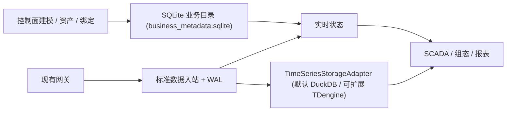

# IoT Thing Model & UNS Engine

面向八位魔方 / IOT-Fast 的 Rust 工业物模型与统一命名空间数据服务。项目采用**业务元数据（SQLite）+ 设备时序数据（可插拔 `TimeSeriesStorageAdapter`，默认 DuckDB，可扩展 TDengine / TimescaleDB / ClickHouse）**分层存储架构，首先打通现有网关的只读数据接入、设备资源定位、实时状态和历史查询，为 SCADA、组态、报表和 AI 提供统一的数据接口。

**当前状态（2026-11-11）：一期（D00.3–D11）设备物模型与 UNS 数据管理引擎本地受控闭环已实现并通过 30 项单元/集成测试、13 项跨语言黄金向量验证与 66 项 OpenAPI 3.1 / JSON Schema 机器契约断言（含 SQLite 14 表业务存储 + DuckDB `v2.0.0` 默认时序存储 + TDengine 可插拔时序存储接口、`ST-02`/`ST-04`/凭据脱敏、`D01.2` 单实例目录锁、`D10.1` 在线一致性快照备份与隔离沙箱恢复校验测试 `storage_sqlite_duckdb_tdengine_test`、独立 HTTP REST + RFC 6455 WebSocket 守护进程 `iotfast_server` 与一键演示脚本 `scripts/mvp-thing-model-demo.py`）。用户已确认外部 `taosd`（TDengine）生产集群实连验收（`ST-06`）、跨库回填迁移（`ST-07`）与存量外部库直读（`P1-REF-READ`）纳入二期范围（`SD-STORAGE-02`）；真实工业网关联调（D09）与目标硬件物理断电/生产压测（D10）仍待现场输入门禁，不得将本地受控闭环等同于现场生产签收。**

**架构边界：** 本项目只负责设备业务模型、数据规范化、实时与历史数据服务；最终用户权限、告警、页面与设备控制由上层平台负责。服务身份和数据范围边界仍由引擎校验。

## AI 开发执行入口

本轮产品决策：保持独立数据引擎；用户体验覆盖 API / SDK 接入与上层管理台参考，不新增引擎内置页面或设备控制。

- [产品定位与成功标准](PRODUCT.md)
- [设备物模型与 UNS 数据管理 MVP 运行与验收手册](docs/development/mvp-thing-model-runbook.md)
- [业务元数据（SQLite）与设备时序数据（DuckDB / TDengine）分层存储验证报告](docs/development/evidence/storage-sqlite-duckdb-tdengine-report.md)
- [接入旅程、异常状态与上层交互参考](docs/product/integration-experience.md)
- [模块边界、事务与运行架构](docs/architecture/implementation-architecture.md)
- [AI 可执行任务包、依赖与验收门禁](docs/development/ai-execution-plan.md)
- [规范冲突收敛与现场输入台账](docs/development/specification-decisions.md)

这些文档提供完整契约与运行指引；在进入 D09/D10 前仍须严格遵守现场输入门禁。

## 建议阅读顺序

0. [数据引擎定位与业务模型规范](docs/architecture/data-engine-scope.md)
1. [完整架构与设计规范](docs/architecture/design-specification.md)
2. [规范入口与优先级](docs/specifications/README.md)
3. [研发路线与任务](docs/development/roadmap.md)
4. [测试与验收](docs/development/acceptance.md)
5. [P0 测试结论总结](docs/development/evidence/p0-core-engine-test-summary.md)
6. [设计决策记录](docs/adr/0001-mvp-boundaries.md)
7. [AI 开发工作规范](AGENTS.md)

补充规范：[服务身份与 D00 公共契约](docs/specifications/service-identity-and-scope-contract.md) · [P0 遥测入站契约](docs/specifications/p0-telemetry-contract.md) · [北向接口与订阅契约](docs/specifications/northbound-api-and-subscription-contract.md) · [D00 跨模块收敛蓝图](docs/specifications/d00-integrated-implementation-blueprint.md)

## 仓库结构

```
iotfast-thing-engine/
├── docs/
│   ├── architecture/           # 架构设计与职责边界
│   ├── specifications/         # P0 契约规范
│   ├── development/            # 路线图、验收条件、MVP 运行手册、测试证据
│   └── adr/                    # 架构决策记录
├── prototype/                  # 物模型与 UNS 数据引擎实现与测试（D00.3–D08）
│   ├── src/
│   │   ├── core/               # 配置校验、D00 契约、错误、健康检查与 HMAC Scope 令牌
│   │   ├── catalog/            # 产品/物模型版本、资产树与跨树拓扑、设备平滑升级、动态+静态引用与 SQLite 业务存储 (sqlite_store.rs)
│   │   ├── ingest/             # 遥测与状态入站校验、WAL 帧恢复、DuckDB 单事务投影与可插拔 TimeSeriesStorageAdapter (ts_adapter.rs)
│   │   ├── query/              # 北向业务视图、设备影子、历史水位线分页与订阅 Hub
│   │   ├── server/             # HTTP/1.1 REST + RFC 6455 WebSocket 传输层（含 /v1/storage/* 接口）
│   │   └── bin/                # iotfast_server（完整守护进程）与 dev_server（烟雾验证入口）
│   ├── tests/                  # 15 个集成测试套件（共 30 项测试，含 HTTP/WS 全链路与 SQLite/DuckDB/TDengine 存储测试）
│   └── feasibility/            # 技术可行性验证与跨语言黄金向量（F0–F3/F6）
├── scripts/
│   ├── mvp-thing-model-demo.py # 设备物模型、UNS 数据管理与存储适配器切换端到端验收演示脚本
│   ├── start-apifox-local-server.py # Apifox 本地在线联调一键启动与种子数据注入脚本
│   └── orca-mvp-smoke.py       # 最小只读 profile 烟雾测试脚本
└── AGENTS.md                   # AI 开发工作规范
```

## 存储分层与可插拔时序架构（`SD-STORAGE-01` / `SD-STORAGE-02` / `ST-02` / `ST-04` / `D01.2` / `D10.1`）

- **业务/控制面元数据存储（SQLite WAL）**：所有控制面目录数据（`product`、`model_revision`、`model_item`、`asset`、`device`、`resource`、`resource_path`、`source_gateway`、`source_device_grant`、`binding_revision`、`point_binding`、`asset_relation`、`edge_adapter`、`derived_metric` 共 **14 张 OLTP 目录表**）权威持久化于 `<data_dir>/business_metadata.sqlite`（启用 `PRAGMA journal_mode=WAL`）。即使删除或重建时序数据库文件，引擎重启时也能从 SQLite 完整恢复业务目录与静态属性配置。
- **设备时序数据默认存储（嵌入式 DuckDB）与单实例锁（`D01.2`）**：设备实时快照与历史遥测（`latest_value`、`point_quality_state`、`last_persisted_value`、`history_observation` **4 张核心时序表**，以及 `applied_message`、`wal_checkpoint`、`storage_delivery_ledger` WAL/投递水位状态表）默认通过 `DuckDbTimeSeriesAdapter` 存储在 `<data_dir>/engine.duckdb`（`v2.0.0`）。引擎启动首步强制执行 `EngineConfig::validate()` 并通过 POSIX `flock(LOCK_EX | LOCK_NB)` 独占锁定 `<data_dir>/engine.lock`（并发双写同一目录立即返回 `409 VERSION_CONFLICT`），同时分配全局唯一 `stream_epoch`（`se-<unix_ms>-<seq>`）。
- **可扩展时序数据库适配器（`TimeSeriesStorageAdapter`）、在线备份恢复（`D10.1`）与二期边界（`SD-STORAGE-02`）**：原生实现 `TdengineTimeSeriesAdapter`（自动创建超级表 `STABLE <db>.stb_observations` 与单资源子表 `tb_<resource_id> USING ... TAGS (...)`、支持 `/rest/sql/{db}` HTTP REST 写入、`LAST_ROW` 最新值查询与 `PARTITION BY resource_id INTERVAL(...) FILL(NONE)` 降采样聚合下推），并支持扩展至 `TimescaleDB` 与 `ClickHouse`（用户已确认外部 `taosd` 生产实例实连 `ST-06`、跨库回填迁移 `ST-07` 与存量外部库直读 `P1-REF-READ` 纳入二期范围）。通过 `GET /v1/storage/status`、`POST /v1/storage/timeseries-adapter`（支持 `strict_lossless: true` `ST-02` 守卫，所有响应中 `tdengine_config.password` 强制脱敏为 `"***REDACTED***"`）、`GET /v1/storage/capabilities`（`ST-02` 能力矩阵握手）、`GET /v1/storage/checkpoints` / `POST /v1/storage/checkpoints:reconcile`（`ST-04` 非连续投递空洞水位线状态机）以及 `POST/GET /v1/storage/backups` / `POST /v1/storage/backups/{id}:verify`（`D10.1` 在线一致性快照备份与隔离沙箱恢复校验）提供运行时存储治理（详见 [存储分层验证报告](docs/development/evidence/storage-sqlite-duckdb-tdengine-report.md)）。

## 设计与实施进度

| 阶段 | 状态 |
|---|---|
| D00 公共契约 | ✅ `Q01–Q12` 已决议并落地，13 项 Rust + 7 项 Python 黄金向量 + 66 项 OpenAPI/Schema 机器契约断言 100% 通过 |
| D01–D08 本地受控闭环 | ✅ SQLite 14 表业务存储 + DuckDB `v2.0.0`/TDengine 时序适配器（含 `ST-02`/`ST-04`/脱敏/`D01.2` 单实例锁/`D10.1` 备份恢复）+ WAL + `iotfast_server`（HTTP/WS）已实现，30 项测试通过 |
| D09 网关联调 | ⏳ 离线回放 Fixture 已验证；真实网关联调待现场输入 |
| D10 故障/性能 | ⏳ 在线备份恢复（`D10.1`）与开发态 F01–F05/容量水位已验证；生产硬件签收待现场环境 |
| 二期外部 TSDB（`SD-STORAGE-02`） | 🗓️ 用户已确认 `taosd` 实连（`ST-06`）、跨库迁移（`ST-07`）与存量直读（`P1-REF-READ`）放下一期；一期已完成适配器接口与线协议预备 |

## 架构约束

- **只读闭环**：首期不内置设备控制，沿用已有网关采集
- **工程值原样**：默认 `normalization_owner = "gateway"`，引擎不做二次换算
- **持久边界**：`accepted_durable` 仅在 WAL `File::sync_all()` 之后返回；通过 `GET /v1/ingestions/{id}` 区分 `status` 与 `history_status`
- **Scope fail-closed**：入口強制验证 HMAC-SHA256 签名令牌、有效期、`source_device_grant` `[valid_from_ms, valid_to_ms)` 半开区间及可信数据范围，拒绝自报 Scope 头（`422`）
- **测量与状态分离**：`iotfast.telemetry.v1` 与 `iotfast.source_state.v1` 独立幂等域

## P0 数据链路



## 文档约束

所有现场地址、量程及倍率示例均为虚构，不能直接用于生产设备。尚未完成真实网关联调、目标环境性能验收、物理断电验证或行业标准认证；原型已有的模拟恢复测试不等同于这些验收。
