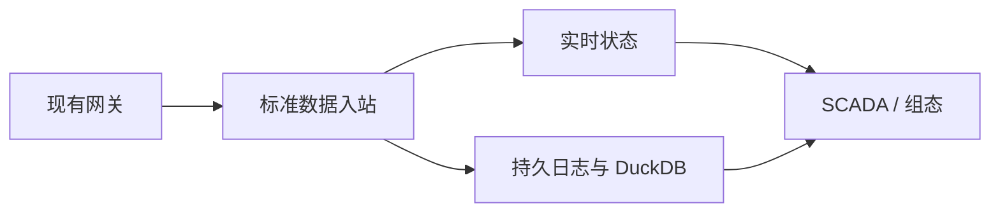

# IoT Thing Model & UNS Engine

面向八位魔方 / IOT-Fast 的 Rust 工业物模型与统一命名空间数据服务。项目首先打通现有网关的只读数据接入、设备资源定位、实时状态和 DuckDB 历史查询，为 SCADA、组态、报表和 AI 提供统一的数据接口。

**当前状态：D01–D08 核心引擎已实现并通过全部 15 项集成测试，含 9 项独立代码审查修复。**

**架构边界：** 本项目只负责设备业务模型、数据规范化、实时与历史数据服务；最终用户权限、告警、页面与设备控制由上层平台负责。服务身份和数据范围边界仍由引擎校验。

## 建议阅读顺序

0. [数据引擎定位与业务模型规范](docs/architecture/data-engine-scope.md)：优先确认服务职责与边界。
1. [完整架构与设计规范](docs/architecture/design-specification.md)：系统总体架构、标准数据规范、协议绑定、UNS、持久化及控制边界；第二部分给出 P0 详细约定。
2. [规范入口与优先级](docs/specifications/README.md)：按主题定位具体规范，并说明冲突处理。
3. [研发路线与任务](docs/development/roadmap.md)：P0 闭环、后续阶段、任务依赖及完成条件。
4. [测试与验收](docs/development/acceptance.md)：契约、可靠性、历史查询和现场联调的验收入口。
5. [P0 测试结论总结](docs/development/evidence/p0-core-engine-test-summary.md)：15 项测试验证范围与结论。
6. [设计决策记录](docs/adr/0001-mvp-boundaries.md)：首期范围与不可假定的事项。
7. [AI 开发工作规范](AGENTS.md)：开发代理在本仓库工作时的阅读顺序和执行边界。

补充文档：[服务身份与 D00 公共契约](docs/specifications/service-identity-and-scope-contract.md) · [P0 遥测入站契约草案](docs/specifications/p0-telemetry-contract.md) · [北向接口与订阅契约](docs/specifications/northbound-api-and-subscription-contract.md) · [D00 跨模块收敛蓝图](docs/specifications/d00-integrated-implementation-blueprint.md) · [技术可行性验证计划](docs/development/feasibility-plan.md)。

## 工程结构

```
iotfast-thing-engine/
├── Cargo.toml                    # 根 crate，duckdb 1.20000.1 + serde/sha2/crc32fast/ryu/hex
├── src/
│   ├── lib.rs                    # 模块入口
│   ├── config.rs                 # EngineConfig
│   ├── error.rs                  # ErrorCode / EngineError 统一错误体
│   ├── d00.rs                    # D00 确定性标识（observation_id, payload_hash, JCS）
│   ├── scope.rs                  # VerifiedScopeContext（fail-closed）
│   ├── health.rs                 # EngineState / HealthStatus / check_engine_health
│   ├── schema.rs                 # 20 张 DuckDB 核心表初始化
│   ├── model_catalog.rs          # 不可变物模型生命周期（D02）
│   ├── asset_uns.rs              # 资产树、设备实例化、UNS 路径重定向（D03）
│   ├── binding.rs                # 网关绑定版本状态机（D04）
│   ├── wal.rs                    # 48 字节 IWAL 帧应用层 WAL（D06）
│   ├── ingest.rs                 # 原子遥测校验与状态事件分离（D05）
│   ├── storage_duckdb.rs         # 单事务 DuckDB 提交与 WAL 恢复（D06/D07）
│   ├── northbound.rs             # 北向业务视图、历史查询（D08）
│   └── subscription.rs           # 实时快照—增量订阅（D08）
├── tests/                        # 15 个集成测试（d01–d08 + review_fixes）
├── feasibility/                  # 技术可行性验证 crate（F0–F3/F6）
├── docs/
│   ├── architecture/             # 架构设计与职责边界
│   ├── specifications/           # P0 契约规范
│   ├── development/              # 路线图、验收条件、可行性计划、测试证据
│   └── adr/                      # 架构决策记录
└── .gitignore
```

## 实现进度

| 阶段 | 状态 |
|---|---|
| D00 契约冻结 | ✅ 完成 — 确定性标识、幂等摘要、跨语言黄金向量验证 |
| D01 工程骨架 | ✅ — DuckDB v2.0.0 健康检查、D00 公共函数、Scope 校验 |
| D02 物模型 | ✅ — 草稿→发布→冻结、版本对比 |
| D03 资产与 UNS | ✅ — 资产树、设备实例化、稳定 resource_id、NB02 重定向锁 |
| D04 绑定 | ✅ — draft→ready→active、禁止二次倍率、旧版本废止 |
| D05 数据入站 | ✅ — 整消息原子校验、SC07 时钟偏移、R03 状态事件分离 |
| D06 持久与幂等 | ✅ — IWAL WAL、F02 尾截断、F05 中间帧停机、T07 背压 |
| D07 状态与历史 | ✅ — 单事务提交、死区/心跳、R08 重试顺序、WAL 恢复 |
| D08 北向查询 | ✅ — DeviceView/Shadow R09、历史 desc/聚合/delivery_gap、订阅 S 边界 |
| D09 网关联调 | ⏳ 待现场输入 |
| D10 故障/性能 | ⏳ 待推进 |

## 构建与测试

```bash
cargo build       # 构建
cargo test        # 全量测试（15 用例）

# 可行性交叉验证
cd feasibility/f1_d00_contract && cargo test && python3 verify_vectors.py
```

## 架构约束

- **只读闭环**：首期不内置设备控制，沿用已有网关采集
- **工程值原样**：默认 `normalization_owner = "gateway"`，引擎不做二次换算
- **持久边界**：`accepted_durable` 仅在 WAL `File::sync_all()` 之后返回
- **Scope fail-closed**：所有入口强制 `VerifiedScopeContext`，空维度拒绝
- **测量与状态分离**：`iotfast.telemetry.v1` 与 `iotfast.source_state.v1` 各有独立幂等域

## P0 数据链路



## 文档状态与约束

职责划分以数据引擎定位与业务模型规范为准；详细设计中的相关旧平台功能不属于引擎范围。设计中如存在矛盾，遵循 [规范优先级](docs/specifications/README.md)，无法判断时登记待决策事项。所有现场地址、量程及倍率示例均为虚构，不能直接用于生产设备。尚未进行真实网关联调、性能测试、故障恢复实测或行业标准认证。
