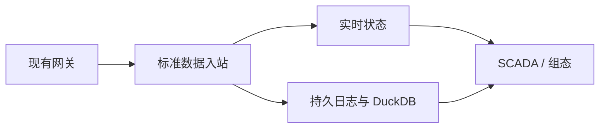

# IoT Thing Model & UNS Engine

面向八位魔方 / IOT-Fast 的 Rust 工业物模型与统一命名空间数据服务。项目首先打通现有网关的只读数据接入、设备资源定位、实时状态和 DuckDB 历史查询，为 SCADA、组态、报表和 AI 提供统一的数据接口。

**当前状态：D01–D08 设计规范已完成，并通过可执行原型验证了可行性（15/15 测试通过）。正式工程实现待启动。**

**架构边界：** 本项目只负责设备业务模型、数据规范化、实时与历史数据服务；最终用户权限、告警、页面与设备控制由上层平台负责。服务身份和数据范围边界仍由引擎校验。

## 建议阅读顺序

0. [数据引擎定位与业务模型规范](docs/architecture/data-engine-scope.md)
1. [完整架构与设计规范](docs/architecture/design-specification.md)
2. [规范入口与优先级](docs/specifications/README.md)
3. [研发路线与任务](docs/development/roadmap.md)
4. [测试与验收](docs/development/acceptance.md)
5. [P0 测试结论总结](docs/development/evidence/p0-core-engine-test-summary.md)
6. [设计决策记录](docs/adr/0001-mvp-boundaries.md)
7. [AI 开发工作规范](AGENTS.md)
8. [AI 工程生成规范和任务拆解](docs/development/ai-implementation-work-breakdown.md)（含 F00–F11 工作包）

补充规范：[服务身份与 D00 公共契约](docs/specifications/service-identity-and-scope-contract.md) · [P0 遥测入站契约](docs/specifications/p0-telemetry-contract.md) · [北向接口与订阅契约](docs/specifications/northbound-api-and-subscription-contract.md) · [D00 跨模块收敛蓝图](docs/specifications/d00-integrated-implementation-blueprint.md)

## 仓库结构

```
iotfast-thing-engine/
├── docs/
│   ├── architecture/           # 架构设计与职责边界
│   ├── specifications/         # P0 契约规范
│   ├── development/            # 路线图、验收条件、测试证据
│   └── adr/                    # 架构决策记录
├── prototype/                  # 设计验证原型（非生产代码）
│   ├── src/                    # 原型引擎模块（D01–D08）
│   ├── tests/                  # 15 个集成测试
│   └── feasibility/            # 技术可行性验证（F0–F3/F6）
└── AGENTS.md                   # AI 开发工作规范
```

## 设计进度

| 阶段 | 状态 |
|---|---|
| D00 契约冻结 | ✅ 确定性标识、幂等摘要、跨语言黄金向量 |
| D01–D08 设计与验证 | ✅ 规范完成，原型验证 15/15 通过 |
| D09 网关联调 | ⏳ 待现场输入 |
| D10 故障/性能 | ⏳ 待推进 |

## 架构约束

- **只读闭环**：首期不内置设备控制，沿用已有网关采集
- **工程值原样**：默认 `normalization_owner = "gateway"`，引擎不做二次换算
- **持久边界**：`accepted_durable` 仅在 WAL `File::sync_all()` 之后返回
- **Scope fail-closed**：所有入口强制 `VerifiedScopeContext`，空维度拒绝
- **测量与状态分离**：`iotfast.telemetry.v1` 与 `iotfast.source_state.v1` 独立幂等域

## P0 数据链路



## 文档约束

所有现场地址、量程及倍率示例均为虚构，不能直接用于生产设备。尚未进行真实网关联调、性能测试、故障恢复实测或行业标准认证。
