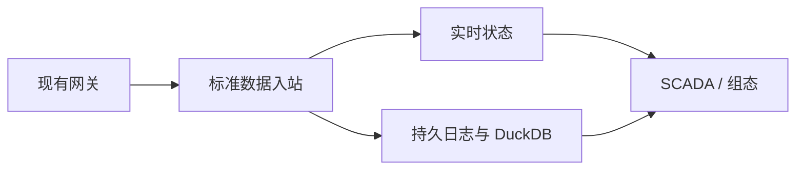

# IoT Thing Model & UNS Engine

面向八位魔方 / IOT-Fast 的 Rust 工业物模型与统一命名空间数据服务。项目首先打通现有网关的只读数据接入、设备资源定位、实时状态和 DuckDB 历史查询，为 SCADA、组态、报表和 AI 提供统一的数据接口。

**当前状态：设计阶段。仓库包含设计草案和研发规范，不包含已实现的服务或经过验证的生产能力。**

**架构边界：** 本项目只负责设备业务模型、数据规范化、实时与历史数据服务；最终用户权限、告警、页面与设备控制由上层平台负责。服务身份和数据范围边界仍由引擎校验。

## 建议阅读顺序

0. [数据引擎定位与业务模型规范](docs/architecture/data-engine-scope.md)：优先确认服务职责与边界。

1. [完整架构与设计规范](docs/architecture/design-specification.md)：系统总体架构、标准数据规范、协议绑定、UNS、持久化及控制边界；第二部分给出 P0 详细约定。
2. [规范入口与优先级](docs/specifications/README.md)：按主题定位具体规范，并说明冲突处理。
3. [研发路线与任务](docs/development/roadmap.md)：P0 闭环、后续阶段、任务依赖及完成条件。
4. [测试与验收](docs/development/acceptance.md)：契约、可靠性、历史查询和现场联调的验收入口。
5. [设计决策记录](docs/adr/0001-mvp-boundaries.md)：首期范围与不可假定的事项。
6. [AI 开发工作规范](AGENTS.md)：开发代理在本仓库工作时的阅读顺序和执行边界。

补充文档：[P0 遥测入站契约草案](docs/specifications/p0-telemetry-contract.md) · [技术可行性验证计划](docs/development/feasibility-plan.md)。

## P0 数据链路

- 网关负责现场协议采集与工程量转换；服务接收工程值并校验模型和绑定版本。
- 每个资源具备稳定 ID、UNS 定位信息、采样时间、质量和来源。
- 默认目标：单 Rust 进程、DuckDB 2.0.0；具体工具链与性能须构建实测。
- P0 先验证模型与只读数据服务；外部时序库与标准映射按阶段验收，MCP 和真实设备控制由上层或独立服务负责。

## 文档状态与约束

职责划分以数据引擎定位与业务模型规范为准；详细设计中的相关旧平台功能不属于引擎范围。设计中如存在矛盾，遵循 [规范优先级](docs/specifications/README.md)，无法判断时登记待决策事项。所有现场地址、量程及倍率示例均为虚构，不能直接用于生产设备。尚未进行真实网关联调、性能测试、故障恢复实测或行业标准认证。
