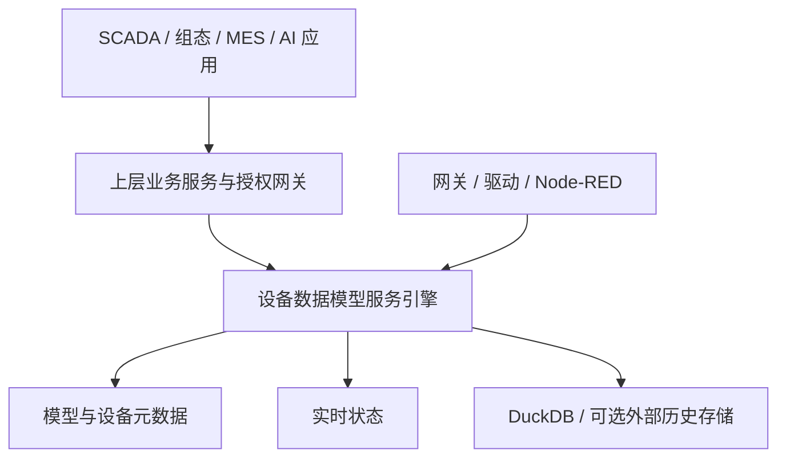

# 数据模型服务引擎定位与设备业务模型规范

状态：根据产品需求确定的架构边界；数据契约、存储和接口细节仍为设计草案，未实现或验证。本文在职责划分上优先于旧设计中的平台权限、告警、命令及控制章节；旧文仅保留为可追溯的候选方案，不是本引擎开发任务。

## 1. 定位与目标

本项目是独立可复用的 **设备业务数据模型与标准数据服务引擎**。统一描述设备类型、设备实例、属性与上下文，将上游采集数据映射成具备统一标识、类型、单位、时间、质量与来源的实时数据及历史数据，并通过稳定接口供多个上层应用消费。

“实时化设备业务模型”指：产品定义和设备实例与实时属性、设备上下文、质量和时间关联，使上层可以通过设备和资源查询当前业务视图；设备属性值并非通过修改已发布模型定义实现。设备型号的可控能力可作为描述元数据；本引擎不负责下发、联锁或物理执行。



## 2. 服务责任分工

| 能力 | 数据引擎 | 上层平台 / 外部系统 |
|---|---|---|
| 产品模型、属性、数据类型、单位、模型版本 | 定义、校验、发布、查询 | 按业务需求配置或展示 |
| 设备实例、资产 / 点位关系、UNS、标准设备视图 | 存储、建立关系、索引、查询 | 业务资产管理界面、项目流程 |
| 网关点位映射和数据转换 | 保存可追溯映射；默认接收网关已转换的工程值并校验 | 网关 / 驱动实际采集；原始值模式另行实现 |
| 实时值、质量、新鲜度、历史和订阅 | 处理、持久化 / 查询与规范化输出 | 界面、策略、告警、业务分析 |
| 用户、角色、菜单、按钮、业务授权 | 不建设用户体系、RBAC 或业务审批 | 上层实现，并在调用前鉴别与授权 |
| 服务调用安全、租户边界 | 实施服务身份验证、边界校验和受信范围执行 | 签发可信服务身份及授权范围，禁止客户端绕过 |
| 告警、通知、工单、设备控制、联锁 | 输出标准数据与能力描述；不执行 | 上层 / 控制服务和独立安全系统负责 |
| MCP / Agent / 展示 | 暴露机器可读数据接口；不内置业务智能体 | 上层按需封装 MCP、AI 工具和用户界面 |

上层承担最终用户权限不等于引擎裸露公网。建议仅内网可达，由可信 API 网关 / 上层服务通过 mTLS 或经过验证的短期服务令牌调用；所选方式必须由部署配置、实际技术栈与安全测试确定。引擎必须验证签名或可信通道、受众、时效、服务身份、数据范围及租户映射；直接传入 tenant_id、用户 ID 或 X-Role 不构成授权。若没有经认证的范围上下文，拒绝调用；不要把内网或客户端提供的头当信任依据。身份和隔离仅是引擎边界能力，不在引擎复制用户管理或权限规则引擎。

## 3. 对象模型与职责

| 对象 | 含义 | 生命周期 / 标识 |
|---|---|---|
| ModelDefinition | 产品类型和业务能力定义：属性、可选事件 / 服务描述、语义及数据约束 | 不可变已发布模型 revision；模型说明不等于真实状态 |
| Product | 设备类型 / 产品目录，关联模型版本 | product_id 稳定 |
| Device | 某台实际设备的业务实例，引用一个已发布模型版本 | device_id 稳定，目录路径可变 |
| Asset | 项目自定义的组织 / 物理位置，可表示工厂、车间或设备位置 | asset_id 稳定；可选多层 |
| Resource | 一台设备的一个可寻址能力或属性 | resource_id 稳定；UNS URI 可重命名 |
| BindingRevision | 外部数据源字段到设备属性的映射及转换责任方快照 | 每设备 P0 同时最多一个 active；历史不改写 |
| Observation | 某属性某一时刻的一个标准化测量事实 | observation_id 在重放与后端间保持一致 |
| LatestState | 按顺序规则从 Observation 投影出的最新值和质量 | 每个资源各自维护，不表示模型定义发生变化 |
| DeviceView | 根据设备、已发布模型、最新状态组装的只读业务视图 | 响应携带所用 revision、时间与质量；不是事实来源 |

业务模型包含设备名称、编号、所属位置、型号、属性描述、物理单位、语义标签和关联上下文；工单、配方、订单、人员与复杂业务流程由上层通过 device_id / resource_id 引用，确有通用扩展需求时另行约定命名空间和版本，不向核心表堆叠业务字段。

## 4. 规范化流程与转换责任

P0 输入为网关已解码并完成工程转换的 engineering value，绑定中保存地址、倍率等以追溯，但引擎不重复换算。引擎依次校验服务身份及数据范围 → 来源 / 设备 / 生效绑定 → 已发布模型与属性 → 类型 / 单位 / 有限范围 → 时间和质量 → 稳定 observation_id → 按配置持久接收 → latest 和历史投影。

可选 engine_raw 模式为后续扩展，需显式配置转换责任、原始类型 / 字节顺序、幂等转换版本及实测，不能与 P0 值混用。超出量程或转换失败按配置拒绝或隔离，不能伪装成正常值；未提供源时钟时标记网关采样时间，不能宣称设备时间；补传标记与测量质量分开。连接在线不等于质量正常或数据新鲜。

### 示例：水泵业务视图

以下为说明性 JSON，不是已完成的 Schema：

```json
{
  "device_id": "pump-001",
  "device_name": "1号循环水泵",
  "product_key": "circulation-pump",
  "model_revision_id": "pump-model-r1",
  "asset_id": "plant-a-room-1",
  "resource_uri": "uns://8iic/plant-a/room-1/pump-001",
  "properties": {
    "running_state": {"value": true, "unit": null, "quality": "good", "freshness": "fresh", "source_at_ms": 1793869200120},
    "pressure": {"value": 0.42, "unit": "MPa", "quality": "good", "freshness": "fresh", "source_at_ms": 1793869200120},
    "current": {"value": 12.5, "unit": "A", "quality": "uncertain", "freshness": "stale", "source_at_ms": 1793869100120}
  }
}
```

本例表示模型及最新点位的组合快照；各属性有各自采样时间，不保证是同一设备周期的原子采样，也不意味着 stale 值当前正常。需用显式 snapshot revision / 采样窗口表达一致性，具体机制待实现和验证。

## 5. 北向标准接口分层

| 类别 | 示例 | 责任 |
|---|---|---|
| 模型目录 | GET /v1/models/{revision} | 返回模型版本、字段约束与语义 |
| 设备与资源 | GET /v1/devices/{id}、GET /v1/resources | 返回设备与稳定资源、UNS |
| 业务视图 | GET /v1/devices/{id}/view | 返回模型 + 当前值 + 各点质量、时间与版本 |
| 实时数据 | GET /v1/devices/{id}/shadow；WS /v1/subscriptions | latest 与增量；无值 / 过期 / 坏质量明确表示 |
| 历史查询 | POST /v1/history/query | 受限 DSL、时间区间、质量过滤、分页及目标库能力 |
| 输入数据 | POST /v1/telemetry | 服务身份、绑定版本、整消息验证和明确的 ACK |

路径为现有设计草案，具体请求字段、错误、认证、兼容性及 OpenAPI / Schema 仍待冻结和测试。标准由本项目定义；WoT / Sparkplug 等需独立映射与一致性验证才能宣称兼容。服务调用和事件作为可选“能力描述”，不提供直接设备控制接口；控制请求由上层 / 设备控制服务独立负责。

## 6. 作用域与访问控制边界

上层对最终用户、应用、设备和操作做业务授权，并通过可信服务身份 / 安全网关将允许的数据域传递给引擎。引擎执行请求级的 tenant / namespace / resource 范围约束以及订阅与历史查询范围约束，所有查询、目录、聚合、分页、缓存和推送都必须受到同一可信范围约束；无法确认范围时 fail closed。不得因为上层负责用户权限而暴露无范围的服务端点给不可信客户端。

模型 / 配置写入仅对经部署方授权的上层服务开放。审计以请求 ID、调用服务身份、动作、资源、结果、时间为主，不负责用户 / 角色管理；如上层传递用户审计标识，作为经过验证的调用上下文，不能单独作为授权依据。多租户隔离模式（数据库 / schema / 行、密钥与资源映射）需按部署制定并验证；tenant_id 字段本身不是隔离机制。

## 7. 数据库职责与一致性

本项目当前基线仍是单进程 DuckDB 2.0.0 作为默认本地数据存储目标、应用 WAL 独立；单机元数据和历史同库策略需先验证。SQLite + DuckDB 是可选方案，MySQL / PostgreSQL 是服务端元数据后端候选，不在未完成验证前切换默认。外部时序数据库通过 Historian 接口作为可选目标；任何后端的精度、质量、同毫秒不同观测和重放语义必须能力测试。

引擎拥有产品 / 模型、设备 / 资源、来源绑定、实时与历史、可靠投递必要表；用户、角色、菜单、审批、工单及业务告警不属于引擎数据库。数据范围、服务身份相关的轻量配置或可信断言验证可按部署实现，但不把业务用户权限关系复制入引擎。

如未来采用 SQLite / MySQL 保存元数据，而 DuckDB 保存历史，不可跨库宣称原子事务。历史写入、去重标记及历史策略基准须留在同一可验证事务域，或设计持久日志 + 幂等恢复并实测；latest 和历史分别返回提交进度。模型 / 绑定变更需要显式版本屏障，确保在不同存储中恢复时仍能解释每个 observation。

## 8. 实施里程碑

- P0-1：冻结设备模型 / 设备视图 / 观测契约和网关映射责任，完成服务边界、数据域与认证协议设计。
- P0-2：模型发布、设备实例、资源目录、绑定、标准数据校验和实时视图；用模拟源先验证。
- P0-3：DuckDB 历史、WAL、幂等、最新值与订阅衔接；故障实测后才可标注 durable。
- P1：一个外部时序库适配、受限历史查询和多平台集成；业务认证接入由上层提供。
- 后续：可选标准映射、关系型元数据适配；MCP 由上层封装，控制由独立控制服务负责。

最低验收：同一种模型创建两台设备，输入各自属性后按 device_id 得到隔离的实时视图；坏质量和 stale 正确显示；模型版本变化不改写历史；不可信调用方不能跨数据范围读取；乱序补传不覆盖较新值；DuckDB 和至少一个外部库的查询能力需分别测试。

## 9. 当前尚待确认

现有网关数据样本及是否已转换；需接入的设备模型类型和首个设备；上层服务的身份验证 / 范围断言机制；并发、保留期、容许丢失与部署环境；SQLite / MySQL / PostgreSQL 元数据适配优先级。本文不声称已实现或经过性能、设备、兼容性及安全验证。
