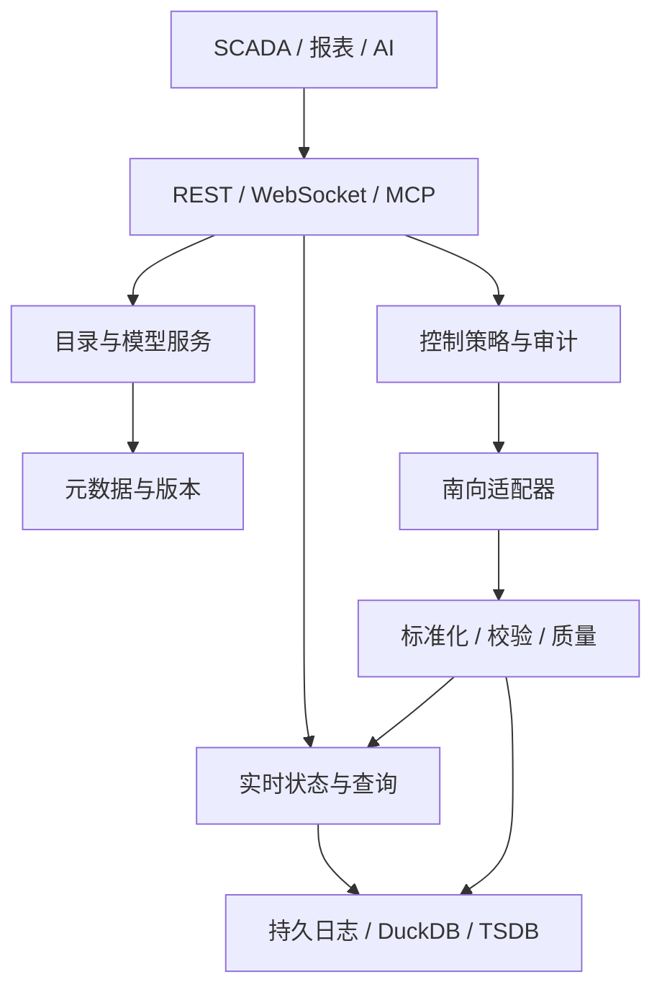

# Rust 工业物模型与 UNS 数据服务设计规范（完善稿）

> **职责边界更新**：本引擎定位为设备业务数据模型与标准数据服务；用户 / 角色 / 菜单、业务权限、审批、告警与物理控制属于上层。引擎保留服务身份验证及可信数据范围隔离。原文相关内容为历史候选，不构成本引擎实施范围，详见 [职责与模型规范](data-engine-scope.md)。


版本：v1.0 设计草案｜日期：2026-11-05  
定位：面向八位魔方 / IOT-Fast 的工业设备建模、实时数据标准化、历史数据查询与 AI 资源目录。  
状态：架构与契约建议；非已实现功能，性能与第三方兼容性均须实测。  
依据：用户提供的《Rust 物模型与设备建模服务设计》PDF；本文延续其中 Rust、DuckDB 2.0.0、UNS、AI 友好目录及多时序库方向，修正其中尚未证实或容易引发歧义的设计。

## 1. 产品目标与边界

将已有网关 / Node-RED / 采集驱动提供的设备数据，转换为具有身份、语义、质量、时间和版本的统一资源，对外供 SCADA、组态、告警、报表和 AI 使用。MVP 采用单 Rust 服务、嵌入式 DuckDB 2.0.0、外部采集适配器；不要求替换现有采集系统。

负责：产品与物模型版本、设备实例、物理资产与目录、协议目录与点位绑定、统一数据与验证、最新值、历史、控制路由与审计、北向查询及订阅。

不直接负责：PLC 内部安全逻辑、替代独立安全联锁、任意协议驱动全部重写、视频媒体流、大模型本身、未经验证的跨库 SQL 功能一致性。

### 1.1 使用者和主要流程

- 集成商：创建产品 → 发布物模型 → 创建设备 → 导入点表和绑定 → 模拟调试 → 接入 SCADA。
- 操作员：定位资产 → 查看实时值 / 质量 → 查询历史 → 经授权发出控制指令 → 查看执行状态和反馈。
- AI：按授权发现资源 → 获取模型与当前质量 → 查询 / 提议操作 → 在服务端校验并按策略确认 → 查看证据。

### 1.2 分期建议

P0：数据契约、单机稳定性与一个真实通道；P1：外部 TSDB 和只读 MCP；P2：Sparkplug / WoT 适配、跨库增强及受控写入。先完成可验证的单厂单产线闭环。

## 2. 原方案中应调整的设计

| 原方案表述 | 调整后的规范 |
|---|---|
| 属性、服务、事件即兼容 WoT | 仅表示概念相近；WoT TM/TD 必须经独立映射、符合必需字段并通过兼容测试后才能声称兼容。服务在 WoT 对应 Action。 |
| 设备统一继承 PackML | PackML 是可选行业 Profile；设备通信状态、工艺状态、安全状态分开建模。OPC UA Part 100 与 PackML 也不能混为一谈。 |
| 单个 64 位质量位图可代表全部质量 | 取消该通用假设；每个观测点携带完整归一化质量与原始质量，保留稀疏点位含义。 |
| q=0/64/128 就是 OPC UA 质量码；补传即 Uncertain | 这是内部可定义的映射，不能称原生 OPC UA StatusCode；延迟补传与测量质量分离，并保留协议原始码。 |
| DuckDB 宽表自动演进覆盖所有设备 | MVP 使用类型化长表并按时间批量入库；宽表 / 列式投影可作为特定场景优化，需基准测试。 |
| 内存队列 + 定时刷盘保证断电不丢 | 内存队列本身不持久；将接收确认分为内存接收与持久提交。需要可靠确认时先写入可恢复的本地持久化日志。 |
| 自动双写、自动回补、自动透明查询 | 指定各存储模式的确认边界、去重、重试与冲突规则；不支持的能力明确报错，不承诺无损透明。 |
| AI 自动生成控制工具即可安全执行 | AI 的描述、语义和工具参数都是不可信输入；确定性权限、完整状态检查、人工确认与物理安全链条不可省略。 |
| 自动归档后立即删除原表 | 归档以 manifest + 校验 + 原子可见切换为中心，恢复可重入；无安全确认前不清理热数据。 |
| 每秒几十万点、零拷贝、完整生产就绪 | 均为待验证目标；记录硬件、数据类型、批量大小、刷盘语义、版本和实测数据，不预设结论。 |

## 3. 总体架构



逻辑模块先组合为单进程，避免早期分布式事务。协议采集系统通过适配器 / HTTP 等接入；模型服务不直接管理所有硬件串口。生产部署中认证、服务边界、TLS 与存储目录由运维配置。

### 3.1 逻辑模块职责

| 模块 | 核心职责 | 边界 |
|---|---|---|
| Registry | 产品、模型草稿、发布、冻结、兼容性 | 发布后不可原位改写 |
| Asset / UNS | 资产树、稳定资源 ID、目录、别名、授权过滤 | 路径是地址，非唯一身份 |
| Protocol Catalog | 协议能力、点位参数 Schema、驱动版本 | 连接密钥与公开描述隔离 |
| Binding | 原始地址到模型属性映射、转换、读写类型 | 发布绑定快照；每条数据可回溯 |
| Ingestion | 校验身份、去重、归一化、补传 | 保留质量及原始值的可配置策略 |
| State | 按点位更新 latest、在线状态、过期 | 接收顺序不能直接当采样顺序 |
| Historian | 可恢复日志、长表、查询及归档 | 必须声明持久确认语义 |
| Command | 授权、校验、确认、派发、反馈 | 超时结果可为 unknown |
| Northbound | 标准 HTTP、订阅、目录、可选 MCP | 业务接口和实时传输分离 |

## 4. 领域对象和标识

| 对象 | 唯一标识 | 定义与约束 |
|---|---|---|
| Tenant / Project | tenant_id / project_id | 单机 MVP 可有默认租户；所有数据归属明确。 |
| Asset | asset_id | 稳定内部 ID；可代表厂、线、设备等，树层级可配置。 |
| Product | product_id / product_key | 同型号产品定义；不包含设备密码或现场地址。 |
| ThingModelRevision | model_revision_id | 对应 product_id + version；发布后内容不可变。 |
| Device | device_id | 设备实例；绑定 asset、model revision 和接入通道。 |
| Property / Service / Event | identifier | 在对应模型版本中唯一；语义信息可独立演进但不能含糊改变类型含义。 |
| BindingRevision | binding_revision_id | 保存通道、地址、转换及驱动版本快照。 |
| Observation | observation_id | 单点测量，携带设备、属性、质量、时间、模型及绑定版本。 |
| Command | command_id / idempotency_key | 一次具体指令，必须可追踪、可审计。 |
| Resource | resource_id | 资源的稳定 ID；UNS 路径为可变位置和检索入口。 |

### 4.1 身份和目录关系

一个产品可以有多个模型版本；一个设备在某一时刻固定绑定一个发布版本；设备迁址不改变 device_id/resource_id；资产树可以多层，实际项目不强制企业/厂/车间/产线/单元齐全。一个属性可引用多个候选绑定，但活动绑定和故障切换规则须显式配置，不自动合并。

## 5. UNS 资源目录规范

### 5.1 命名规范

示例 `uns://8iic/fz-plant/smt/line-01/oven-02/properties/zone1_temp`。scheme 为本系统自定义资源 URI，不宣称是现有通用标准。authority 为租户或组织短名；路径按实际资产分层，尾部类型包括 properties、services、events、state。MVP 只支持 ASCII slug `[a-z0-9][a-z0-9_-]{0,63}`；显示名称独立存储；拒绝空段、`.`、`..`、非法转义与保留段冲突。路径大小写规范为小写，长度上限由配置定义（默认建议 1024 字节），不能将任意原始路径直接当数据库标识符。

设备移动或重命名时，在同一事务更新当前路径并生成旧路径重定向 / 失效记录；历史事件绑定稳定 resource_id 和当时的 path snapshot。重定向有效期与复用禁令由项目策略决定；旧路径不得静默指向另一设备。权限按稳定资源及授权树计算，路径变化时重新计算。

### 5.2 路径、订阅与通配符

- 资源读取：输入完整 URI 或 resource_id，返回 canonical URI、resource_id、revision 和可访问的描述；按身份进行过滤。
- 树浏览：root、depth、分页 cursor；只返回有权节点，不暴露被拒资源的详情。
- 订阅：WebSocket 订阅表达式使用独立的 filter 字段，`+` 匹配单段，`#` 仅可作为末尾整段、匹配零或多段。它是本系统定义的过滤语法，非自动等同 Sparkplug topic；拒绝 URI 和 filter 混用。
- 资源哈希只可作索引辅助；冲突时需比较完整 resource_id / path，不作为主键或安全边界。
- 配置快照带 `catalog_revision`；客户端断线重连先重新获取 latest 快照，再开始接收增量；订阅流仅支持在线投递，断开窗口可能丢失中间变化，可靠历史依赖 historian / WAL。接入支持恢复的持久事件流后才可声明连续重放。

## 6. 物模型 DSL

### 6.1 版本、兼容性和生命周期

`draft → published → deprecated → retired`。编辑只修改草稿；发布时执行结构校验、标识冲突、类型约束、协议绑定完整性及安全策略检查，产生不可变快照、摘要与版本。设备升级需显式指定旧 / 新模型、兼容性报告、绑定变更计划、回滚窗口；历史观测仍引用采集时版本，不就地改写历史。

- 新增可选只读属性一般向后兼容；删除属性、变更 identifier / 类型 / 单位 / 控制语义为破坏性变更。
- 新增必填服务参数、缩小允许范围属于潜在破坏性变更，需人工确认并迁移；即使版本号未变也不得静默覆盖。
- 枚举新增可能影响客户端穷举，标记为兼容性警告；约定 unknown 扩展策略。
- 回滚指设备切回已发布版本，不删除已经写入的历史；旧绑定是否仍可用须重新校验。

### 6.2 字段定义

顶层：`spec_version`（规范版本）、`product_key`、`model_version`（产品模型版本）、`name`、`description`、`profiles`、`properties`、`services`、`events`。禁止把 spec_version 和 model_version 混成一个字段。

属性：`identifier`、`name`、`description`、`data_type`、`access`（read / read_write）、`semantic`（量纲、设备角色和可读说明）、`unit`、`value_constraints`、`sampling_policy`、`storage_policy`、`ui_hints`。`required` 描述完整快照或服务入参时的必填性，不意味着每个增量上报必须包含所有属性。工程转换与现场地址存在 Binding，不与型号定义强绑定。

服务：identifier、入参 / 出参 Schema、业务语义、可用性前提、超时、风险等级、确认策略、反馈要求。事件：identifier、类型、严重度和 payload schema；事件与告警实例不是同一概念。

支持 int64、float64、boolean、string、enum、timestamp、struct、array；v1 的 JSON int64 为避免 JavaScript 超精度风险，超出安全整数范围时采用十进制字符串表示并明确编码。float 拒绝 NaN 和 Infinity；步长验证采用明确的十进制 / 容差策略，金额和高精度值需扩展 decimal；文本长度以 Unicode 字符数计，数组 / 结构需声明深度及大小限制。枚举保留源值与规范值的映射，不强制所有设备原始值必须是字符串。单位由受控词表给出，显示符号与换算关系分离。

### 6.3 示例：产品模型片段

```json
{
  "spec_version": "1.0.0",
  "product_key": "reflow_oven_x1",
  "model_version": "1.0.0",
  "name": "回流焊炉",
  "properties": [{
    "identifier": "zone1_temp",
    "name": "一温区实际温度",
    "description": "一温区热电偶测得的实际温度",
    "access": "read",
    "data_type": {"type": "float64", "min": -40, "max": 450},
    "unit": {"code": "Cel", "symbol": "°C"},
    "semantic": {"quantity": "temperature", "role": "actual", "zone": "1"},
    "storage_policy": {"mode": "change_or_heartbeat", "deadband": 0.5, "heartbeat_ms": 60000}
  }],
  "services": [{
    "identifier": "set_zone_target_temp",
    "name": "设定温区目标温度",
    "risk": "high",
    "confirmation": "required",
    "input": {"type": "object", "required": ["zone_index", "target_val"], "properties": {"zone_index": {"type": "integer", "minimum": 1, "maximum": 8}, "target_val": {"type": "number", "minimum": 50, "maximum": 300}}}
  }],
  "events": []
}
```

示例为本规范设计草案，不代表已发布的官方 Schema；`unit.code` 仅示例，实施时需确定并校验采用的单位词表。模型里的数值边界只是有效参数范围，不等同现场安全工况范围。

## 7. 协议目录、通道与点位绑定

### 7.1 三层分离

1. Protocol Catalog：协议能力字典（例如 Modbus TCP、OPC UA、IEC 104、MQTT、HTTP、自定义协议）；定义适配器标识、版本、支持的操作、配置参数 Schema 和使用示例。目录不代表所有驱动已开发。
2. Channel：现场连接实例，包含驱动类型、连接配置引用、连接状态、超时 / 重试 / 流控及密钥引用；密钥不得进入模型、AI 目录或普通日志。
3. Point Binding：设备属性 / 服务与具体通道地址的映射、读写能力、原始类型、字节序、比例换算、采集周期、质量映射、版本。

### 7.2 Modbus 点位示例

某现场绑定：protocol=modbus-tcp、channel=channel-01、unit_id=1、function=read_holding_registers、address=100、address_base=zero、register_count=1、raw_type=uint16、byte_order=AB、scale=0.1、offset=0，目标 `zone1_temp`。这些数字是示例，并非某设备真实地址；创建时必须明确零基地址与厂商 40001 显示地址的换算方式。多寄存器还须声明 word_order；写入还要定义反向换算、溢出、取整及下发功能码。

处理顺序：原始报文解码 → 协议质量映射 → 工程量换算 → 类型 / 范围判定 → 标准观测 → 实时值与历史策略。原始值、转换参数及绑定版本按策略保存；转换异常不伪造成有效值。死区按工程值执行；实时 latest、存储历史、订阅各自的过滤策略应独立。

## 8. 运行期标准数据

### 8.1 遥测信封

```json
{
  "spec": "iotfast.telemetry.v1",
  "message_id": "018f0000-0000-7000-8000-000000000001",
  "source_id": "gateway-01",
  "source_epoch": "boot-20261105-01",
  "device_id": "dev-oven-02",
  "model_version": "1.0.0",
  "binding_revision_id": "bind-rev-12",
  "received_at_ms": 1793869200125,
  "points": [{
    "property": "zone1_temp",
    "value": 245.6,
    "source_at_ms": 1793869200120,
    "quality": {"state": "good", "reason": null, "source_code": "0x00000000"},
    "delivery": {"replayed": false, "sequence": 1001}
  }]
}
```

UTC Unix 毫秒为 v1 统一外部时间；时区仅用于呈现。`source_at_ms` 缺失时标记时间来源并使用接收时间，但不得伪称设备时间；`received_at_ms` 由服务填写。质量状态为 good / uncertain / bad / unknown；附来源协议原始质量码、映射版本及原因。补传标记属于 delivery，与质量独立。连接在线不能证明数据有效；数据过期由 freshness / stale 标识表达，不覆盖原始质量。

入站须限制包大小、点数、嵌套深度和速率；未知设备、未绑定、未定义点位与不合法数据按可配置拒绝 / 隔离策略处理，原始异常日志需限流脱敏。批量部分成功必须逐点返回状态；若要求原子批次则整个拒绝并事先约定。

### 8.2 去重、顺序和 latest

去重 key 首选 `(tenant_id, source_id, source_epoch, sequence, device_id, property)`；若来源无序号，由适配器持久生成 source_epoch 与 sequence，不能依赖重启后不稳定的随机 ID。接收消息 ID 必须在重试时保持不变。去重元数据保留期应覆盖最大重放窗口，并由目标存储支持持久判断；如果实现不了，明确为至少一次 + 可能重复。不同原始来源冲突按绑定优先级 / 生效区间处理。

latest 更新按 `(source_at_ms, sequence)` 与定义好的同时间 tie-break 比较；缺失、漂移或未来时间超阈值进入异常策略，不让旧补传覆盖新状态。若不同来源时间不可比较，需声明由接收序列决胜的降级模式并标记时间可信度。历史仍保存有效迟到数据。

### 8.3 影子

reported 为真实上报及质量 / 时间；desired 为客户端申请的目标，含 command_id、有效期与状态，绝不视作已生效。默认不对离线工业设备自动缓存或重放控制；设备恢复后由人或已授权业务重新确认。影子更新使用 revision + 条件写，防止并发覆盖。设备通信状态、点位质量、新鲜度、设备工艺状态独立显示。

## 9. 控制命令闭环与安全

### 9.1 生命周期

`created → validated → awaiting_confirmation（如需） → queued → dispatched → acknowledged → verified`；任何适用阶段可进入 rejected / expired / failed / cancelled；派发后无确定反馈进入 `unknown`。acknowledged 仅代表适配器或设备确认接收，不代表动作完成；verified 必须基于指定反馈点和可配置窗口，不能从 TCP / Modbus 写成功推断物理动作成功。

### 9.2 确认机制

由服务端根据风险等级、设备、参数、操作人、模型 / 绑定版本、截止时间和当前状态生成确认申请；确认令牌绑定申请摘要及主体，一次使用、短时过期、防重放，且不能由 AI 自行审批自身操作。确认后派发前重新检查权限、数据新鲜度、工况、联锁和绑定是否变化。取消与超时策略必须区分派发前和派发后；派发后取消不能承诺撤销物理动作。

控制必须由认证主体授权，服务端自行读取身份和范围，不能信任请求中 caller_id。默认拒绝未知状态、坏质量、旧数据和离线控制。所有阈值和权限来自现场经过审定的配置；AI 检索结果和提示词不是安全策略。紧急停机和独立安全回路由经现场验证的硬件安全系统承担，不依赖本服务或模型判断。

### 9.3 幂等与重试

`idempotency_key` 在租户、调用者、资源和动作范围唯一，关联请求参数摘要；同 key 同参数返回原命令，不同参数报冲突。派发后出现超时或断网时状态为 unknown，不自动重发非幂等命令；可根据设备端明确的去重协议、反馈读取及人工处置再判断。审计记录操作者、来源、意图、参数、授权、确认、版本、派发、反馈和时间，敏感信息脱敏。

## 10. DuckDB 及可插拔时序存储

### 10.1 数据面与控制面

默认 DuckDB 2.0.0 面向单进程嵌入式；同一数据库文件由一个服务进程持有写入职责，进程内按照实测配置连接和工作线程。历史读经服务 API，其他进程不要直接抢占同一文件。与现有 Go 服务集成优先 HTTP / IPC，不跨进程直接访问同一数据库文件。2.0 的其他远程方案单独验证，MVP 不依赖。

元数据逻辑域：products、model_revisions、assets、devices、binding_revisions、resource_paths、commands、audit、dedupe。历史域建议类型化长表：`telemetry_numeric / telemetry_text / telemetry_bool / telemetry_json`，公共列包括 tenant_id、device_id、property_id、source_at_ms、received_at_ms、quality、source_quality_code、source_id、source_epoch、sequence、model_revision_id、binding_revision_id。按事件时间查询并对高频路径建立经过实测的物理布局。历史数据写入类型改变由模型版本区分。产品宽表作为后续物化投影，质量、稀疏更新、属性重命名和超过 64 点场景要独立验证。

命令 / 确认 / 注册等低并发事务与高频历史隔离为逻辑工作负载；早期可同一进程管理不同文件，但跨文件不承诺单事务。是否把元数据迁至 SQLite 作为可选工程决策，基于真实并发与故障测试，不改变本阶段 DuckDB 默认要求。

### 10.2 持久化和确认语义

定义两种接收：`accepted_volatile`（进入内存，进程故障可能丢）和 `accepted_durable`（追加持久日志并按配置达到持久提交边界，重启可重放）。只有达到 durable 才可向上游宣称可靠接收；由配置决定同步方式与最大容许丢失窗口，需断电 / 强杀实测，不将 fsync 理论等同硬件保证。持久日志空间不足时拒绝 / 背压，不假装成功。

接收 → 校验 → WAL 追加与持久确认 → 批量写入 DuckDB → 更新提交 checkpoint → WAL 回收。若 DuckDB 已提交但 checkpoint 未提交，重放会重复；因此写入和去重标记需在同一 DuckDB 事务中持久化，或用可验证的幂等写入 / 去重索引，完成后才推进 checkpoint。归一化数据与消息 ID 原样记录。实时 latest 与历史提交可以存在时间差，API 必须返回 freshness 和持久状态，不能宣称同步原子。WAL 故障、损坏、队列满和磁盘高水位都须有明确指标和告警。

### 10.3 存储路由模式

| 模式 | 成功确认 | 故障与恢复 |
|---|---|---|
| local | WAL durable 后接收，DuckDB 异步落库；也可配置等待历史提交 | WAL 重放；背压时拒绝新数据。 |
| remote-primary | 先本地持久排队；外部写入确认后标记 remote committed | 断网继续本地缓存直到配额；恢复后按键去重补传；不同确认级别对调用方可见。 |
| dual | 各目标独立 checkpoint，给出 local / remote 独立状态；要求双目标确认时明确更高延迟和可用性代价 | 不承诺分布式原子事务；至少一次重试和幂等策略由适配器声明。 |

接入 TDengine、TimescaleDB、InfluxDB 等使用独立适配器与能力表：批量写、去重、回放、聚合、插值、类型、保留、排序、时间精度、事务、最大批次、错误分类。启动时协商；不支持的能力返回 `CAPABILITY_UNSUPPORTED`，不静默降级或声称所有 SQL 可通用。

### 10.4 查询 DSL

请求包含资源 ID 列表 / 受授权的目录过滤、半开时间区间 `[start,end)`、字段、质量过滤、采样窗口、聚合、填充、时区、限制、排序和 cursor；构造 AST 并限定白名单，严格使用参数绑定，不允许原始 SQL 从 AI 或客户端透传。默认查询 raw / good-only 与否应明确由请求给出。插值只适用于数值并需显式选择；不得把插值伪装成真实观测；结果带原始 / 聚合 / 插值标记。限制跨度、资源数、返回数、并发和超时。

### 10.5 归档和故障恢复

分片写临时 Parquet → 完成并关闭文件 → 校验范围、计数、校验和 → 原子提交 manifest → 切换读路径 → 确认备份 / 保留策略后再删除热分片。中断后依据 manifest 重试或清理孤儿文件；边界使用半开区间，迟到数据进入增量分片或单独补丁并经去重合并，避免跨冷热重复或漏数。需要验证重启、断电、读写并发和备份恢复。数据保留期限以项目配置为准。

## 11. 北向 API 草案

| 方法与路径 | 用途 | 关键语义 |
|---|---|---|
| POST /v1/products | 创建产品 | 唯一 product_key，幂等键 |
| POST /v1/products/{id}/models | 创建草稿 | 输入 Schema，返回 revision |
| POST /v1/models/{revision}/publish | 校验并发布 | immutable，失败返回结构化问题 |
| POST /v1/devices | 注册设备 | 固定已发布模型版本 |
| POST /v1/devices/{id}/bindings | 创建绑定草稿 | 校验通道与地址 |
| POST /v1/bindings/{revision}/activate | 激活绑定 | 并发版本检查、可回滚 |
| GET /v1/resources | 按 resource_id / URI 查找 | 身份过滤、返回 canonical URI |
| GET /v1/resources/tree | 分页浏览资产 | root、depth、cursor |
| POST /v1/telemetry | 网关数据上报 | 明确 durable / volatile、逐点结果 |
| GET /v1/devices/{id}/shadow | 获取实时影子 | reported、desired、质量及 revision |
| POST /v1/history/query | 历史 AST 查询 | 资源授权、限制、能力报错 |
| POST /v1/devices/{id}/commands | 提交操作 | 幂等键，返回 command_id 与状态 |
| POST /v1/commands/{id}/confirm | 人工确认 | 单次、过期、主体绑定 |
| GET /v1/commands/{id} | 查看执行 | 区分 acknowledged / verified / unknown |
| WS /v1/subscriptions | 实时订阅 | 鉴权、过滤、流控、断线重取快照 |

错误结构统一：`code`、`message`、`details`、`request_id`、`retryable`；HTTP 状态码表达传输结果，业务错误码表达具体原因。例：MODEL_TYPE_MISMATCH、RESOURCE_NOT_FOUND、AUTH_FORBIDDEN、BINDING_INACTIVE、DURABLE_BUFFER_FULL、COMMAND_EXPIRED、RESULT_UNKNOWN、CAPABILITY_UNSUPPORTED。被无权访问的资源返回策略避免泄露存在性；外部错误不暴露密钥和内部栈。

## 12. AI 原生目录和 MCP

### 12.1 可理解目录

每个资源返回机器字段 + 可读语义：resource_id、canonical_uri、类型、中文名、英文名 / 别名、所属设备和位置、模型版本、描述、semantic quantity / role、单位、精度、值域、质量 / 新鲜度、权限范围、数据来源、引用关系、更新时间及可信来源。涉及控制还需风险、参数 Schema、确认要求、可用性、反馈方式；当前值与语义描述分开。

所有目录描述均视为不可信数据，不可覆盖系统指令；不能把设备名称、备注和协议说明直接当 AI 指令执行。基于授权做精确检索 / 关键词 / 标签 / 层级过滤；向量检索可选，返回匹配依据、模型版本和索引时间，不由相关度保证事实为真；实时异常需查询 live 质量、当前值和告警，而不是仅查询语义索引。

### 12.2 MCP 设计

MVP 可先提供稳定、有限的工具：`browse_resources`、`search_resources`、`get_resource`、`get_latest`、`query_history`；AI 控制放后续灰度，通过 `prepare_command` / 受权限限制的 `submit_command` 对接同一控制服务，而不是每个设备生成无限多个工具。MCP 采用与目标客户端协商的协议版本；网络侧优先 Streamable HTTP，本地可用 stdio；旧 SSE 仅在确有兼容要求时独立支持。所有工具执行经过统一身份、授权、查询限制和审计；敏感控制需操作员在可信界面完成确认。

## 13. 行业标准适配边界

| 标准 | 用法 | 声称兼容的条件 |
|---|---|---|
| W3C WoT TD / TM | 产品能力和实例描述导入 / 导出候选 | 单独映射、字段与交互 / 安全描述校验、适配范围和兼容性测试；不能只因 PSE 相似就声称兼容。 |
| ISA-95 / IEC 62264 | 参考企业 / 场所 / 区域等建模理念 | UNS 层级是项目选择；不声称某条路径完整实现标准信息模型。 |
| Sparkplug 3.0 | 可选 MQTT 桥接、生命周期与标准 payload | 正确实现对应角色、主题、消息、序列及状态管理并通过相应一致性测试；DBIRTH 不自动等于完整内部物模型。 |
| OPC UA | 南向节点及质量来源适配 | 原始 StatusCode 原样保留并定义可验证映射；不要把内部简化码称为原生码。 |
| PackML | 可选离散 / 包装设备状态 profile | 现场设备映射明确、质量与状态可信；不作为所有设备默认前提。 |

## 14. 模块与目录建议

```text
thing-engine/
  apps/server/             服务入口与配置
  crates/domain/           产品、设备、资源、观测、命令
  crates/contracts/        请求、响应、Schema 及版本
  crates/model-registry/    草稿、发布、兼容性检查
  crates/asset-directory/   资产树、资源路径、权限范围
  crates/protocol-catalog/  协议目录、绑定描述
  crates/ingestion/         数据验证、归一化、去重
  crates/state/             最新值、影子、在线状态
  crates/historian/         WAL、批量写、查询、归档
  crates/storage-spi/       能力协商、统一接口
  crates/storage-duckdb/    默认持久化适配
  crates/commands/          指令、授权检查、确认、审计
  crates/api-http/          REST、WebSocket
  crates/api-mcp/           可选 MCP 适配
  crates/adapter-sdk/       南向对接契约
  schemas/                  版本化 JSON Schema 和示例
  fixtures/                 标准输入、输出及错误样例
  docs/                     架构、迁移与运维说明
  tests/                    契约、故障恢复与端到端
```

目录只是建议，不代表已生成源码；接口与模型应优先于具体 crate 拆分稳定。避免将无稳定边界的每项能力过早独立部署。

## 15. 端到端示例：回流焊炉

1. 发布回流焊模型 1.0.0，定义一温区实际温度和目标温度服务。
2. 在 SMT 产线创建 oven-02，绑定模型版本及 Modbus 网关，标注单站号、地址基准、原始类型、比例系数、采集周期。
3. 原始寄存器值 2456，经 0.1 比例转换为 245.6 °C；保留数据时间、质量、原始质量与绑定版本；写 latest 和可靠历史。
4. 组态画面通过 UNS 发现资源，首次读影子并订阅增量；设备断线后显示离线和数据过期，不把旧值呈现为当前正常值。
5. 操作员请求目标温度 255 °C；系统执行授权、参数、最新设备状态和项目联锁检查；高风险请求等待人工确认。
6. 人工确认后再次检查工况并派发；设备仅确认接收则显示 acknowledged；指定反馈点达到目标 / 满足策略后显示 verified；超时显示 unknown / 未验证，不自动重发。

## 16. 实施里程碑与验收

以下时间仅为安排顺序，不代表人员承诺或已完成；每一阶段基于现有驱动接口和现场设备条件估算。

| 阶段 | 交付 | 验收 |
|---|---|---|
| P0-0 契约 | 词汇表、Schema、示例、版本和安全策略 | 使用合法 / 非法样例验证；明确接收 / 持久边界；现场确认协议地址。 |
| P0-1 模型与目录 | 产品、草稿、发布、设备、资产路径、版本固定 | 发布不可变；设备迁址保持 ID；冲突及权限测试通过。 |
| P0-2 数据闭环 | 一个真实网关或 Modbus 模拟器、绑定、latest、DuckDB 历史 | 原始值→工程值可追溯；bad、stale、乱序 / 补传正确。 |
| P0-3 故障恢复 | WAL、去重、背压、重启及监控 | 每个故障点 kill -9 后恢复，与发送清单逐条比对；磁盘满不误报 durable。 |
| P0-4 查询与控制 | 历史查询、只读组态、命令审计及确认 | 请求幂等；确认一次性；超时 unknown；安全条件改变拒绝派发。 |
| P1 | 单一外部 TSDB、只读 MCP | 实际断网缓存 / 补传比对；能力不支持明确报错；AI 无权越界。 |
| P2 | 标准适配、更多协议和可控 AI 工具 | 独立兼容性测试及安全联调后再扩大范围。 |

### 16.1 测试矩阵

- 契约：类型边界、精度、单位、未知点、服务必填 / 多余字段、Unicode、最大消息限制。
- 版本：旧设备绑定、破坏性模型更新、升级失败和回滚、历史按旧版本解释。
- 通信：设备在线但点位 bad、source time 漂移、重复、迟到、乱序、绑定切换。
- 持久：WAL append / fsync、DuckDB commit 前后、checkpoint 更新前后逐点注入崩溃；断电在目标机器验证；磁盘耗尽、损坏与恢复。
- 控制：越权、篡改、重复确认、令牌过期、状态变化、离线、ACK 与实际反馈不一致、设备无反馈、命令重复。
- 查询 / 归档：半开时间边界、迟到点、冷热重叠与空档、汇总 / 插值标注、DST 只影响展示、查询超限。
- 性能：说明 CPU / RAM / 磁盘、操作系统、DuckDB / Rust 版本、点数 / 秒、点类型、设备数量、连接数、数据质量占比、持久模式与持续时间；记录吞吐、P50/P95/P99、WAL 体积、丢失 / 重复数、恢复时间和磁盘写放大。

### 16.2 关键开放决策

1. 首个交付形态：独立边缘进程还是嵌入现有网关发行包；上游可靠重传是否已有。
2. 实际采集规模与采样分布、数据保留期限、可接受丢失窗口与断网最长时间。
3. 第一条真实协议接入和驱动接口；是否需要离线边缘独立运行。
4. 控制权限主体来源、现场联锁信号与负责人、是否具备实际反馈点。
5. 外部 TSDB 首选、去重能力及历史数据一致性目标。
6. 用户现有八位魔方 / IOT-Fast 的设备模型、数据结构和集成边界。

## 17. 权威资料与待验证事项

- DuckDB Rust Client：https://duckdb.org/docs/2.0/clients/rust/overview ；DuckDB 并发：https://duckdb.org/docs/2.0/connect/concurrency 。以用户要求的 DuckDB 2.0.0 为目标，需锁定 Rust crate 与实际链接引擎版本，并在目标系统构建验证。
- W3C WoT Thing Description 1.1：https://www.w3.org/TR/wot-thing-description/ 。
- Sparkplug 3.0：https://sparkplug.eclipse.org/specification/version/3.0/ 。
- MCP 官方 Rust SDK：https://rust.sdk.modelcontextprotocol.io/ 。

本文提供架构、契约和验收设计，不包含生产代码。尚未完成真实工程构建、性能测试、硬件联调、标准认证或现场安全验证。

---

# 第二部分：P0 详细设计与开发验收补充（v1.1）

> 本部分在保留第一部分总体目标的基础上，明确 MVP 的默认行为。若与第一部分的可选建议不一致，以本部分对应的 P0 约定为准。所有 API、参数和阈值均为设计草案，不代表已实现或经过性能验证。
>
> 时间范围：先打通“现有网关或模拟器 → 温度点位 → Rust 服务 → 实时值 / DuckDB → 组态查询”。MVP 不要求新建完整 Modbus 主站驱动，也不默认开启生产设备写入。

## 18. MVP 范围、部署边界及能力分期

### 18.1 本阶段确认的默认架构

单机单 Rust 进程负责模型 / 绑定 / 入站 / latest / 历史 / 查询；外部已有网关承担设备协议通讯。MVP 采用 DuckDB 2.0.0 目标版本作为嵌入式元数据与历史存储，外加独立的应用层顺序持久日志；这不是 DuckDB 自身 WAL 的别名，也不依赖外部队列。单机试点先只开放读取；服务控制采用本规范设计但列为后续受控联调任务。

操作模式：`gateway_normalized`：现有网关完成 Modbus 协议解码、比例换算、质量转换，向引擎发送工程值；引擎只校验模型及绑定版本，不再次执行倍率。点位绑定保存原始地址 / 换算配置与来源信息供管理、校验与追溯。若网关不支持携带以上信息，则不宣称服务端能够从工程值反推出原始值。`engine_raw` 模式作为后续独立能力；它与 gateway_normalized 不得在同一条观测中混用或重复换算。

| 阶段 | 必须交付 | 不作为该阶段验收 |
|---|---|---|
| P0-A 基础闭环 | 产品、模型发布、设备、绑定、入站、latest、历史、资源定位 | 实际生产控制、跨库查询 |
| P0-B 持久可靠 | durable ACK、去重、重放、背压、重启恢复测试 | 断电零丢失的无条件保证 |
| P0-C 展示闭环 | 资源树、详情、实时订阅、历史查询、异常状态 | 断线期间实时订阅消息连续 |
| P1 | 一个外部 TSDB、只读 MCP、实际现场联调 | 所有存储后端的同等事务和查询能力 |
| P2 | 命令真实适配、联锁、确认以及行业标准映射 | 无现场验收直接宣称安全合规 |

P0-A 可用 `accepted_volatile` 完成演示；P0-B 未验收前不得宣传可靠持久化、断电不丢。P0 需要现场设备时，真实 Modbus 驱动可由既有网关提供；无设备时只证明模拟数据链路。

### 18.2 默认租户和身份

单机初期初始化一个租户与一个项目；结构保留 tenant_id 和 project_id。用户 / 客户端身份由网关鉴权层生成的可信主体确定，网关上报绑定授权到其 source_id 与设备范围。请求体中的 tenant_id、操作者字段、路径均不作为权限依据。单机不等于免鉴权：初始凭据通过部署安全通道配置，日志与 AI 目录禁止输出。

## 19. P0 数据模型与实际存储设计

### 19.1 核心实体表（逻辑定义）

下表是逻辑模型，不是已经在 DuckDB 创建或验证的 DDL。主键采用不可复用的服务端 ID；业务键及命名空间唯一性约束在事务中校验。时间字段除另有说明都为 UTC Unix 毫秒。

| 实体 | 关键字段 | 唯一性 / 约束 |
|---|---|---|
| `products` | tenant_id, product_id, product_key, name, status, revision | `(tenant_id, product_key)` 唯一；软停用不复用 ID。 |
| `model_revisions` | model_revision_id, product_id, version, spec_version, body, content_hash, lifecycle, published_at | `(product_id, version)` 唯一；published 内容及其 hash 不可变。 |
| `assets` | asset_id, tenant_id, parent_asset_id, slug, name, revision | 同级 slug 唯一；禁止环和跨租户挂接。 |
| `devices` | device_id, tenant_id, product_id, model_revision_id, asset_id, status, revision | 模型需属于同一产品且为已发布版本。 |
| `resources` | resource_id, tenant_id, device_id, kind, identifier, model_revision_id | 某个设备及模型版本内 `(kind, identifier)` 唯一；稳定身份与路径独立。 |
| `resource_paths` | path_id, resource_id, canonical_uri, valid_from, valid_to, redirect_until | 当前路径在租户内唯一；历史路径保留其生效区间。 |
| `sources` | source_id, tenant_id, auth_ref, enabled, last_seen_at | 仅保存密钥引用；授权设备范围单独管理。 |
| `binding_revisions` | binding_revision_id, device_id, model_revision_id, status, hash, effective_from, effective_to | 对同一设备某一时间最多一个 active 快照；发布内容不可变。 |
| `point_bindings` | binding_revision_id, property_id, channel_ref, protocol, address_config, transform, normalization_owner, validation | 属性在快照中唯一；无采集点属性允许 unbound 但不允许伪造上报。 |
| `applied_messages` | tenant_id, source_id, source_epoch, message_id, body_hash, outcome, wal_position | 去重键 `(tenant_id, source_id, source_epoch, message_id)` 唯一；hash 不同冲突。 |
| `history_observations` | observation_id, device_id, property_id, model_revision_id, binding_revision_id, value, quality, times, source sequence | 强类型逻辑表可拆 numeric / text / bool / json；按业务测试确定实际物理布局。 |
| `latest_values` | resource_id, value, source_at, received_at, quality, freshness, precedence_key, history_status, revision | 单资源最多一个当前值；latest 是历史之外的投影，不改变历史事实。 |
| `audit_log` | audit_id, tenant_id, principal_id, action, target_id, before_hash, after_hash, result, occurred_at | 不记录密码；保留和导出策略由部署配置。 |

删除模型 / 设备默认采用停用和引用检查；已有历史依赖的记录不得级联删除。数据库实际索引、约束、事务冲突行为及 DuckDB 更新性能均须在目标版本实测；不能凭表结构直接推断吞吐。

### 19.2 归档时间与历史模型解释

历史行始终持有采集时的 `model_revision_id` 和 `binding_revision_id`；修改名称、单位或设备位置不追溯改写旧观测。历史查询默认按采集时属性语义返回；跨模型版本聚合只允许单位 / 数据类型 / 语义兼容，不能证明兼容时返回 `CROSS_VERSION_INCOMPATIBLE`。展示当前设备位置与采集时位置时分别返回当前资源路径与采集时可用的目录快照 / 时间生效映射；尚无该数据就明确 `location_at_source_time=unknown`。

## 20. 产品到点位绑定的详细规范

### 20.1 输入与验证顺序

创建产品 → 编辑模型草稿 → 模型校验 → 发布不可变版本 → 建资产及设备 → 注册网关来源 → 编辑绑定草稿 → 校验 / 模拟 → 激活绑定 → 网关确认已应用 → 数据准入。设备可先建立但状态为未就绪；未激活绑定不接受生产遥测。

绑定发布执行如下校验：

1. 设备和发布模型归属一致，属性存在、标识唯一、采集权限为允许上报。
2. 标明通道、协议、设备地址、数据类型、地址基数、转换责任方与变更摘要；网关能力声明允许该绑定。
3. `normalization_owner=gateway` 时入口只能接工程值，`raw_value` 可作为可选证据字段；不由 Rust 服务二次执行比例换算。
4. 显式校验源数值的整型宽度、字符数、字节 / 寄存器长度、变换后类型、步长和溢出规则；无法验证现场设备本身时，状态显示“配置校验通过，现场未验证”。
5. 敏感连接信息只存凭据引用；测试连接必须经操作员授权，不随 AI 检索自动触发。

### 20.2 一条 Modbus TCP 绑定示例

以下假设由现有网关采集，数值、地址均为演示，切勿直接用于生产控制。

```json
{
  "device_id": "dev-oven-02",
  "model_revision_id": "mr-oven-1",
  "source_id": "gateway-01",
  "normalization_owner": "gateway",
  "points": [{
    "property": "zone1_temp",
    "protocol": "modbus-tcp",
    "channel_ref": "channel-01",
    "unit_id": 1,
    "read": {"function_code": 3, "address_zero_based": 100, "register_count": 1},
    "raw_type": "uint16",
    "raw_byte_order": "AB",
    "conversion": {"kind": "linear", "factor": 0.1, "offset": 0.0},
    "engineering_unit": "Cel",
    "sample_interval_ms": 1000
  }]
}
```

`address_zero_based=100` 表示协议数据单元中的零基地址；厂商手册的 4xxxx 展示编号不与之混用。上述 `AB` 只描述单个 16 位寄存器的字节排列；多寄存器类型还必须定义 word_order，具体命名应提供字段级定义与正反例。采样周期是期望配置，实际采样受网关、网络及设备影响。

### 20.3 绑定切换状态机与迟到数据

绑定状态：`draft → ready → active → superseded`；取消草稿可 `discarded`。MVP 每台设备只允许一个 active 绑定。为了避免切换期间错用配置：

1. 管理端提交新 revision，并使用设备 revision 条件更新；版本冲突返回 409。
2. 新配置下发到网关，网关显式 ACK（包含 binding_revision_id 与内容 hash）；失败继续使用旧版本。
3. 服务端记录生效边界并激活新版本；网关必须在上报中携带实际使用的 revision。
4. 旧 revision 的迟到数据仅在可证实其采样发生于旧版本生效区间时按旧快照接收；时间不可信或无法证明时进入隔离 / 拒绝并说明原因，不拿当前配置重新解释。重放期、允许时间偏差和清理周期可配置。
5. 启用协议侧支持的读回检查；网关与引擎无法达成一致时标记 `binding_sync_pending`，并停止使用无法确认版本的数据。回滚创建新激活记录，保留先前版本和审计。

该流程需要现有网关支持配置版本确认。如果没有该能力，MVP 采用人工停采 → 配置 → 校验 → 启采窗口，期间数据标记缺口；禁止假装完成无缝切换。

## 21. 数据入站、幂等与 ACK 契约

### 21.1 请求约定

`POST /v1/telemetry`，示例请求头 `Authorization: Bearer <credential>`、`Content-Type: application/json`、`X-Request-Id: req-001`；支持 `Prefer: durability=durable` 或 `durability=volatile`，未声明时使用部署策略并在响应中明确实际结果；如果客户端要求 durable 而服务无法达成，不得降级返回成功。

```json
{
  "spec": "iotfast.telemetry.v1",
  "message_id": "m-20261105-000001",
  "source_id": "gateway-01",
  "source_epoch": "epoch-001",
  "device_id": "dev-oven-02",
  "model_revision_id": "mr-oven-1",
  "binding_revision_id": "br-oven-12",
  "points": [{
    "property": "zone1_temp",
    "value": 245.6,
    "source_at_ms": 1793869200120,
    "source_time_origin": "gateway_sample",
    "source_seq": "1001",
    "quality": {"state": "good", "source_protocol": "modbus", "source_code": null},
    "delivery": {"replayed": false}
  }]
}
```

`source_seq` 使用十进制字符串，避免 JSON 在 JavaScript 客户端发生整数精度丢失；同一 `(source_id, source_epoch, device_id, property)` 内应单调递增。网关通过可持久化序列或持久 epoch 避免重启碰撞，重试时 message_id、source_epoch、source_seq 和语义内容保持相同；epoch 不要求跨重启固定，但重新生成后不得与旧 epoch 重用，并应持久保存至当前未确认数据全部完成。设备无时钟时 `source_time_origin=gateway_sample`，不能称为设备测量时间。服务自行生成 received_at_ms 和可信主体。

### 21.2 批次原子性与幂等键

P0 选择 **整消息原子接受**：同一设备一条消息内的所有 points 校验通过后整体入日志；若任何点不合格，整条拒绝，返回逐点错误列表，不产生部分成功。一个消息内 property 不得重复，数量 / 字节 / 深度限制由配置设置并展示。此规则覆盖第一部分所提可选的逐点部分成功模式，后者留待后续版本。

幂等键是服务端主体映射的 `(tenant_id, source_id, source_epoch, message_id)`。`source_id` 必须与认证身份授权一致。服务将客户端可控的业务内容按版本化 canonical representation 求摘要，忽略服务端赋值字段及会因每次传输变化的 trace/request_id；对 replayed 字段约定它只作为传输标记、不纳入业务摘要，也不改变观测事实。去重 key 相同、摘要相同视为同一请求；摘要不同返回 `409 IDEMPOTENCY_CONFLICT`，禁止静默覆盖。

并发重复请求需要在单进程内对该 key 做互斥 / pending 记录；第一个请求达到其承诺的提交边界前，第二个等待同一结果或获得可重试响应，不得同时分别生成可见记录。重启后由持久日志 / applied_messages 恢复去重状态；volatile 模式不能承诺进程重启后的去重。去重保留期必须覆盖网关重传窗口，窗口过期的重复请求不得声称可被识别。

### 21.3 响应与查询

- 新消息已达 durable WAL 边界：HTTP `202`，`status=accepted_durable`、`message_id`、`ingest_id`、`history_status=pending`；202 表示接收持久化，不等于 DuckDB 可查询。
- 新消息仅驻留内存：HTTP `202`，`status=accepted_volatile`、`history_status=pending`；不能将其视为可恢复。
- 在去重窗口内重复：HTTP `200`，返回 `status=duplicate`、原 ingest_id 与当前已知 history_status；原消息仍 pending 时不误报 committed。
- 参数 / 类型错误：HTTP `422`，整消息拒绝，返回各字段错误；未授权 `403`、版本冲突 `409`、限流 / 背压 `429` 或 `503`，并返回 retryable / retry_after_ms（按实际故障条件）。
- `GET /v1/ingestions/{ingest_id}` 查询 `durable / pending / committed / failed`；权限按来源 / 项目过滤，明确查询状态记录保留时间。`accepted_durable` 只是本服务所声明的本地持久边界，不等同多副本或断电实验通过。

示例响应：

```json
{
  "request_id": "req-001",
  "ingest_id": "ing-001",
  "message_id": "m-20261105-000001",
  "status": "accepted_durable",
  "history_status": "pending"
}
```

### 21.4 已有网关的最低改造接口

网关需要配置服务地址、身份凭据引用、source_id、设备 / 模型 / 绑定版本和可靠队列策略。它负责按约定上送工程值、源时间、质量、持久稳定的消息标识与序列；超时后以原 key 重试，收到 durable ACK 才能按约定释放本地消息。网关如果只支持无 ID 的内存即时推送，只能按 volatile / 尽力交付接入，不承诺重启后不丢或准确去重。历史遗留接口可由外置桥接进程适配，但桥接必须先持久化收到的数据才能提供 durable 语义。

## 22. 质量、时间、死区与 latest 规则

### 22.1 质量与时间

| 情况 | 对质量的处理 | latest 与历史 |
|---|---|---|
| 正常读数 | `quality=good` | 正常比较时序，按策略保存。 |
| Modbus 连接超时 | `quality=bad`、reason=timeout；无新有效测量值 | latest 的质量 / 新鲜度更新为 bad，不把旧值作为新采样；可保留 last_known_value 并附原时间。 |
| 补传一条原来 good 的数据 | 仍为 good，`replayed=true` | 写历史；按顺序规则判断是否更新 latest。 |
| 无源时间 | source_at 使用接收侧采样时刻并标记来源 | 若无法保证比较关系，按明确降级策略处理并带时间可信度。 |
| 设备时钟未来漂移超阈值 | `clock_status=invalid`；原始时间保留 | 默认隔离，禁止刷新 latest；阈值仅为项目配置。 |
| 停止更新超过 stale 阈值 | 原质量不改，freshness=stale | last_known_value 可展示，但界面必须标示陈旧。 |

定义每个资源分开存储 `value_sampled_at` 与 `quality_observed_at`。若连接故障没有新值，则状态更新不能构造出一个具有新时间戳的虚假测量；历史中可额外记录质量变化事件，但不得当作新的测量点。P0 latest 的完整质量 / 过期规则需要与现有网关的实际故障消息协商。

### 22.2 顺序规则

同一个活动 source_epoch 内，按 `(source_at_ms, source_seq)` 进行比较；时间可信且不同则以 source_at 决定，时间相等再比较数值型 source_seq。不同 epoch 或来源的 seq 无法直接比较：来源切换以配置的活动绑定与生效边界决胜；旧 epoch 补传只写历史，不覆盖活动新 epoch 的 latest，除非明确经过恢复策略验证。无法确定先后关系时，不强行覆盖，标记并记录原因。source_seq 是字符串编码，比较时按受限无符号整数语义处理，不能按字典序比较。

### 22.3 死区与心跳

对工程值按属性配置判断 `abs(new - last_persisted) >= deadband` 或心跳间隔到期时存储，两个条件为 OR；死区为 0 时所有有效新观测均可存储。质量由 good 变 bad / 恢复 good 时无条件记录质量事件。原始值、latest、实时订阅、历史四条策略彼此独立：默认 latest 更新所有通过准入的较新值；历史做死区 / 心跳；订阅默认无额外死区但受流控。第一条合法观测必须进入历史，存储上次持久基准在重启后可恢复，不应因重启使死区语义被静默改变。

历史过滤发生在消费 WAL 的确定性事务中：应用算法所需状态、历史记录、消息去重和提交标记一起更新；无历史写入但完成过滤的消息也要标记为已处理。示例中 245.6→245.9、deadband=0.5 且尚未心跳，则 latest 可为 245.9 而历史不新增；达到心跳条件后按最新可用观测记录采样及质量信息。

## 23. 应用层 WAL 与 DuckDB 的恢复设计

### 23.1 分段与记录格式要求

应用日志目录与 DuckDB 数据目录在同一设备或不同设备时都必须单独监控空间。每条记录包含格式版本、长度、校验和、ingest_id、去重键、业务摘要、认证后的租户 / 来源、绑定版本、规范化数据与写入序号。分段文件有身份 / 顺序和完整性信息；同时将最大记录大小 / 段大小限制写入配置。日志内容可能包含生产数据，文件权限、保留期、备份和密钥政策必须明确；不在日志写访问令牌。

`accepted_durable` 需要完成记录写入并达到配置的同步边界；一次批量 sync 可以确认多个请求，但每个 ACK 均不得早于自身数据在该批 sync 中完成。具体系统调用、文件 / 目录元数据同步以及存储设备写缓存行为要针对目标 OS 与文件系统设计并实测。窗口化 async flush 只能称为 `accepted_volatile`，不能因“之后通常会落盘”宣称 durable。

### 23.2 恢复步骤和故障矩阵

启动时先锁定服务实例 → 读取已提交 checkpoint → 校验日志从安全位置向后扫描 → 对尚未在 DuckDB 标记应用的消息幂等重放 → 建立 latest / 目录状态 → 检查待同步绑定 → 依健康条件启用入站。尾部不完整记录可在校验后截断；中间记录校验失败属于损坏，停止该分段继续自动重放并告警，不跨过故障后宣称无缺失。故障演练必须覆盖以下时刻：

| 崩溃时点 | 客户端看到的可能结果 | 恢复要求 |
|---|---|---|
| WAL 写入前 | 超时 / 未收到 ACK | 原 key 可重试，不产生记录。 |
| WAL 写入但未达同步边界 | 未收到 durable ACK | 按校验结果恢复或丢弃尾部；客户端以原 key 重试。 |
| 同步完成但 ACK 发出前 | 客户端可能超时 | 原 key 重试返回已有 ingest_id，避免重复历史。 |
| DuckDB 事务中 | 尚未对历史确认 | 未提交事务回滚后重放完整消息。 |
| DuckDB 已提交、checkpoint 未更新 | durable 已确认；历史可能已提交 | 通过同事务内的 applied_messages 判重，不重复应用。 |
| checkpoint 已更新、日志未清理 | durable 已确认 | 启动可跳过已确认范围；后续安全回收。 |

事务必须将“历史写入 / 过滤状态 / 消息应用去重标记”放在同一个 DuckDB 事务中；不支持这一边界的实现不得声称此方案已经成立。启动读取日志与数据库所产生的最新值，必须避免把尚未持久的旧缓存覆盖新观测。

### 23.3 背压与保留

配置 WAL 磁盘配额、内存队列长度、单条消息大小、最大消息数及软 / 硬水位。软水位报警并限制速率；硬水位拒绝新 durable 请求并返回可重试状态，不静默丢弃已确认记录。日志回收仅覆盖已安全提交且所有必要消费者 checkpoint 已越过的分段；P0 单消费者，P1 多存储各自 checkpoint，不能用单一 checkpoint 假装两个目标都完成。示例默认值只能用于测试，部署上线前由采样负载、磁盘空间、最长离线时间和恢复速率测量决定。

## 24. 北向查询与实时订阅详细设计

### 24.1 资源与最新值

`GET /v1/resources?uri=<url-encoded-uri>` 返回 `resource_id`、canonical_uri、device_id、property、model_revision_id、描述、单位、授权内的能力。资源 URI 在查询参数中必须 URL 编码；后端解析本规范路径，不能当文件路径。

`GET /v1/devices/{device_id}/shadow` 返回 revision、每点 value、value_sampled_at_ms、quality_observed_at_ms、received_at_ms、quality、freshness、model_revision_id、history_status；网关断线与点位过期分开展示。无值时明确 `value=null` 与 `quality=unknown`，不以 0 代表缺失。

### 24.2 快照与订阅衔接

WebSocket 建连后先认证，再提交订阅条件。服务端在资源状态更新的同一有序域内，先注册订阅并取得边界序号 S，再生成与 S 一致的快照；S 之后的变更进入有界缓冲。发送 `snapshot_begin`、快照项、`snapshot_end`（含 S），随后按序发送缓冲和新增量。若生成快照期间缓冲溢出或无法提供一致边界，返回 `resync_required` 并终止本轮订阅；不得声称连续无缺口。

事件带 `subscription_id`、服务实例 `stream_epoch`、单调递增 `stream_seq`、resource_id 和最新 revision；这些序号只用于本次实时流，不替代持久历史序列或承诺重连重放。队列按容量限制，慢客户端可合并相同资源的最新值并明确 `coalesced=true`；要求逐次保留的用途走持久化历史通道。服务重启或客户端断线必须重新订阅并拉一致快照，断线期间的瞬时变化只能从已持久化历史查询。

### 24.3 历史查询示例

```json
{
  "resource_ids": ["res-oven-02-zone1-temp"],
  "range": {"start_ms": 1793865600000, "end_ms": 1793869200000},
  "mode": "raw",
  "quality_states": ["good", "uncertain", "bad"],
  "order": "asc",
  "limit": 500,
  "cursor": null
}
```

时间为 `[start_ms,end_ms)`，P0 原始值分页稳定排序键为 `(source_at_ms, observation_id)`，cursor 与授权、查询条件和快照范围绑定且防篡改。对大量迟到数据，分页在 P0 可选择固定查询快照或首次查询的接收水位；若后端无法提供固定快照，则明确其弱一致性和潜在漏重风险，客户端应按 observation_id 去重并对时间窗口重查。raw、聚合、插值为不同模式，结果标记类型；P0 优先 raw，聚合与插值仅在适配器明确支持且经测试后开放。

## 25. 面向 AI 的目录与工具契约

### 25.1 资源目录返回示例

```json
{
  "resource_id": "res-oven-02-zone1-temp",
  "canonical_uri": "uns://8iic/fz-plant/smt/line-01/oven-02/properties/zone1_temp",
  "kind": "property",
  "name": "一温区实际温度",
  "description": "回流焊炉一温区实际测量值",
  "semantic": {"quantity": "temperature", "role": "actual", "zone": "1"},
  "data_type": "float64",
  "unit": {"code": "Cel", "symbol": "°C"},
  "model_revision_id": "mr-oven-1",
  "readable": true,
  "writable": false,
  "current": {"value": 245.6, "quality": "good", "freshness": "fresh", "sampled_at_ms": 1793869200120},
  "catalog_revision": "cat-1042"
}
```

名称、描述、别名和来自第三方设备的文本都是数据，不能作为系统提示或工具操作指令。当前值可能陈旧，AI 回答应携带值、单位、采样时间和质量；`freshness=stale` / bad / unknown 时不得描述为当前正常值。权限过滤必须先于关键词或向量检索和结果排序。

### 25.2 工具清单与错误行为

| 工具 | 输入 | 输出 / 限制 |
|---|---|---|
| browse_resources | 授权 root、depth、cursor | 仅授权资源，分页 / 限数 |
| search_resources | query、类型、区域、cursor | 名称 / 别名 / 标签 / 层级过滤；返回匹配依据和索引时间，不保证搜索结果完整 |
| get_resource | resource_id | 完整描述和模型版本；无权限按统一隐匿策略处理 |
| get_latest | resource_ids | 值、时间、单位、质量、新鲜度与缺失原因 |
| query_history | 资源、时间、模式、质量、limit | 仅受限 DSL；配额 / 超时 / 不支持均显式报错 |

以上先提供只读工具；`prepare_command`、`submit_command` 仅在真实权限、独立安全系统、可信确认界面和反馈机制完成后引入。工具身份应由 MCP 传输认证和服务端上下文决定，不能让模型自行填写更高权限的 caller_id。协议版本及 SDK 以实施时锁定的真实版本和客户端兼容测试为准。

## 26. 最小交互与页面状态

| 页面 / 区域 | 关键操作 | 必须可见的状态 |
|---|---|---|
| 产品与模型 | 新建产品、编辑属性、校验、发布 | 草稿 / 已发布、破坏性变更、版本、字段校验错误 |
| 资产与设备 | 建资产树、绑定产品 / 模型版本 | 未绑定、停用、网关未授权、设备离线 |
| 绑定向导 | 选择已有网关、配置属性映射、查看样例 / 激活 | 地址基准、转换责任方、版本对齐 / 待同步、试运行是否真实联机 |
| 设备详情 | 当前点位、质量、来源时间、连接状态 | 正常、bad、stale、unknown、无值、最后一次成功时间 |
| 趋势查询 | 时间、资源、质量过滤、原始值 | 数据缺口、时区、查询范围、只展示真实或标记聚合 / 插值 |
| 运行维护 | 接收量、持久队列、存储、历史写入、最后错误 | volatile / durable、磁盘水位、重放中、背压、故障与处理建议 |

入口以集成商能完成闭环为目标：模型 → 设备 → 绑定 → 实时值 → 历史；AI 查询是其上的只读入口。具体前端技术沿用现有平台，不把 Rust 服务绑死到 UI 框架。

## 27. 功能任务拆解与验收用例

### 27.1 开发任务包

| 编号 | 前置依赖 | 任务 / 产出 | 可验证完成条件 |
|---|---|---|---|
| D00 | 无 | 冻结术语、JSON 样例和错误结构 | 本文各示例通过 JSON 解析；关键默认语义经团队审阅。 |
| D01 | D00 | 工程启动 / 配置 / 健康检查、依赖版本锁定 | 目标平台可启动并记录实际 Rust、DuckDB crate 与链接引擎版本；此项须真实构建。 |
| D02 | D01 | 产品与模型草稿 / 发布 | 非法模型拒绝；发布版本不可原位修改。 |
| D03 | D02 | 资产树、设备、UNS 与路径改名 | ID 不变、同级路径冲突拒绝、历史路径不复用。 |
| D04 | D02/D03 | 来源授权、绑定草稿 / 校验 / 激活 | 未授权源无法上报；绑定版本不一致被拒绝。 |
| D05 | D04 | 入站验证 / 质量 / 工程值契约 | 一条非法点导致整消息拒绝；单位及版本一致。 |
| D06 | D05 | 应用层 WAL、ACK、幂等、重放 | 通过 F01–F05 故障注入；未完成前只提供 volatile。 |
| D07 | D06 | DuckDB 历史、checkpoint 与 latest 投影 | 重复请求和重放不重复历史；乱序不覆盖最新值。 |
| D08 | D07 | 影子、实时流、历史查询与限额 | 快照衔接不漏在线变更；溢出强制 resync。 |
| D09 | D08 | 网关适配及端到端联调 | 从模拟器 / 指定真实设备到画面验证完整链路；明确数据来源。 |
| D10 | D09 | 故障 / 性能报告、部署与运维 | 按现场环境记录可复现数据、限制和未通过项。 |
| D11 | D09 | 只读 MCP，按优先级排期 | 越权资源不可见；返回质量时间；查询配额生效。 |
| D12 | D09 + 现场安全条件 | 真实控制与确认链路，后续独立验收 | 现场签认后运行；不能从模拟验收推断真实安全。 |

### 27.2 必须通过的测试向量

| 编号 | 输入 / 条件 | 预期 |
|---|---|---|
| T01 | 原始寄存器 2456、比例 0.1，网关上报工程值 245.6 | 服务储存 245.6，不再乘 0.1；保存所用绑定 revision。 |
| T02 | 同消息含合法温度与未定义属性 | 整消息 422，所有点均不被接受。 |
| T03 | 同 key 同内容重传 | 返回原 ingest_id，历史仅应用一次。 |
| T04 | 同 key 改变温度 | 409 IDEMPOTENCY_CONFLICT，不覆盖原数据。 |
| T05 | 先收到源时间 10:00:02 值 25，再补传 10:00:01 值 24 | 历史包含两次合法观测，latest 保持 25。 |
| T06 | 连接超时，无新测量值 | 点位质量转 bad，last_known_value 保留旧采样时间，不伪造新测量。 |
| T07 | 客户端请求 durable，但日志已达硬水位 | 请求失败并可重试，不返回 accepted_durable。 |
| T08 | 绑定新版本已激活，收到无法证明采样时段的旧版本消息 | 隔离或拒绝，不按新配置解释。 |
| T09 | 订阅初始化时持续更新且缓冲不足 | 返回 resync_required；不静默漏掉在线更新。 |
| T10 | AI 只授权产线 A，查询产线 B | 不返回 B 的资源和当前值，工具调用也不能绕过。 |

故障测试 F01–F05 分别对应 23.2 中的前五个崩溃时点。测试前建立包含 message_id、payload hash、预计历史结果的外部独立发送清单，故障恢复后逐项核对；强杀进程和实际断电是不同测试，分别记录。重放验证需覆盖 durable ACK 已返回 / 客户端未知两种情况。

## 28. 开发启动检查与仍待确认的输入

可先使用假定配置推进设计和模拟器，不要将其标为现场事实。正式实施前需要：

1. 现有网关与平台的接口资料：当前消息格式、是否带消息 ID / 质量 / 采样时间、能否保存重传队列和接收绑定版本。
2. 选定首个真实协议点位：设备型号、通信拓扑、手册中的地址基准、数据类型、字节序、倍率、采集周期；所有地址须现场核实。
3. 运行环境与规模：目标系统 / CPU、内存、磁盘、设备数、点数、平均及峰值采样频率、保留周期和最长离线时间。
4. 可靠性目标：是否必须 durable、可容许丢失窗口、断网缓存容量、恢复时限；必须由项目 / 现场共同确认。
5. 身份 / 设备控制：现有用户系统、角色及厂区授权；首期是否只读，写控制独立进行安全和现场验收。
6. 后续标准与存储：第一候选外部 TSDB，以及 W3C WoT / Sparkplug 实际互通对象与测试范围。

当前完成状态：**详细设计草案已补充；JSON 形式和文档一致性可检查，但实际软件、数据库、目标网关和硬件尚未运行或验证。**
