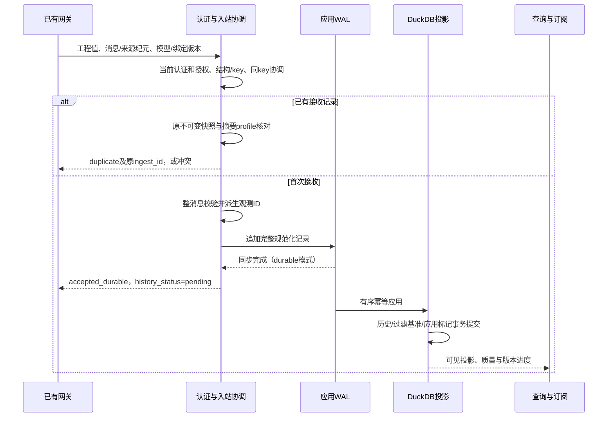

# 数据引擎实施架构与收敛门禁

## 1. 文档定位、证据与优先级

**状态：文档任务包；架构实施建议和静态审计，不是生产实现或验收报告。** 本次只新增本文，不修改代码、详细契约或既有证据，不执行重编译、自动测试、现场接入或性能测试。审计对象为当前工作区：已有未提交的原型目录整理和说明更正，不能把工作区观察当作已合并版本结论。

全文使用三种状态：

- **现状**：实际读取文件可以确认的结构、函数路径或既有报告的记载；不表示本次执行验证。
- **设计**：已写入现有契约的目标约束，或本文明确标注的实施建议；不以文档代替机器契约。
- **待现场确认**：网关、身份系统、运行环境和可靠性指标等尚缺输入；没有输入时不得编造默认生产参数。

阅读及冲突顺序遵循 [AGENTS](../../AGENTS.md)、[规范入口](../specifications/README.md)：职责以 [数据引擎定位](data-engine-scope.md) 为准；同一 P0 行为以 [总体设计第二部分（18–28）](design-specification.md#18-mvp-范围部署边界及能力分期) 覆盖第一部分；详细契约细化而不悄悄覆盖冲突。发现矛盾先登记和评审，不自行采用更宽松规则。另已对照 [项目入口](../../README.md)、[ADR 0001](../adr/0001-mvp-boundaries.md)、[路线图](../development/roadmap.md) 和 [验收入口](../development/acceptance.md)。

本文不新增 wire 字段、错误码、状态枚举或数据库表定义。字段、ID 生成、摘要和传输形式分别引用以下唯一主题入口：

| 主题 | 详细契约及使用规则 |
|---|---|
| 服务身份、Scope、ID、摘要、状态事件、错误 | [D00 公共契约](../specifications/service-identity-and-scope-contract.md)；保持 `VerifiedScopeContext`、`message_key`、`sha256-jcs-v1` 和确定性 `observation_id` 规则 |
| 遥测与 ACK | [P0 遥测契约](../specifications/p0-telemetry-contract.md)；工程值、整消息校验、可靠接收与历史提交分离 |
| 模型、设备、绑定、视图、订阅和历史 | [北向契约](../specifications/northbound-api-and-subscription-contract.md)、[设备业务模型](../specifications/device-business-model.md) |
| 逻辑表与事务 | [数据库设计](../specifications/database-schema-design.md)；逻辑表名与原型物理列不得混为一套已冻结 DDL |
| 外部历史目标 | [时序存储](../specifications/timeseries-storage.md)、[存储适配器契约](../specifications/storage-adapter-contract.md)；能力实测后开放 |
| 跨模块历史对账 | [D00 集成蓝图](../specifications/d00-integrated-implementation-blueprint.md)；其旧候选及证据状态冲突见第 8 节 |

特别区分：模型属性叫 `identifier`，遥测点叫 `property`，逻辑表可叫 `property_identifier`；它们属于不同契约层，不通过全局改名“统一”。`gateway_normalized` 是运行模式，`normalization_owner="gateway"` 是转换归属，不是两个可互换的字段值。服务令牌中的 Scope 逻辑示例也不是允许客户端明文传入的授权协议。

## 2. 系统边界与模块责任

### 2.1 部署与业务边界（设计）

首期保持独立、可复用的 Rust 单进程数据引擎：已有网关采集和工程转换 → 引擎模型、绑定、准入、持久接收、latest、历史、查询 → 上层应用。默认目标为本地 DuckDB 2.0.0，另有独立应用 WAL；不以 DuckDB 自身 WAL 代替应用接收日志。目标版本必须与实际链接版本分开记录。

上层负责 UI、最终用户和 RBAC、业务权限决策、告警通知、审批、工单、MCP/Agent 封装及设备控制。引擎负责服务身份验证、租户与资源范围执行、受控配置写入及必要审计。数据闭环“只读”意指不下发物理设备控制，不是禁止经授权的模型和绑定管理。能力描述中的 `read_write` 不是可执行控制权限。上层页面仅是消费接口和异常状态的参考，本任务不交付 UI 或服务代码。

### 2.2 逻辑模块（设计，不要求拆微服务或新增 crate）

| 模块 | 拥有的职责 / 状态 | 边界与依赖 |
|---|---|---|
| 服务入口与可信上下文 | 协议解析、认证、限额、统一错误、请求审计上下文 | 只有认证适配层生成可信上下文；不得由请求体反序列化后直接信任 |
| 模型与目录 | 产品、不可变模型、资产、设备、稳定资源、路径有效区间 | 发布和实例化采用元数据事务；业务系统按稳定 ID 引用，不按可变 URI 作为事实主键 |
| 来源与绑定 | 来源授权、映射快照、版本条件更新、网关 ACK / 人工停采证据 | 不接管网关驱动；一个设备同时最多一个 active 绑定；不再执行网关倍率 |
| 入站协调器 | 当前授权、幂等协调、整批校验、确定性 ID、接收结果 | 同 key 必须一个首次接受结果；历史重试不得被当前绑定错误拦截 |
| 应用 WAL 与恢复 | 帧完整性、同步、接收索引、分段、恢复与安全回收 | 不把内存队列当持久化；恢复记录能解释原模型、绑定和摘要 profile |
| 本地投影与历史 | 消费 WAL；历史策略、去重、latest、质量及连续 checkpoint | 历史/过滤基准/应用标记同一 DuckDB 事务；latest 不等于历史最后一行 |
| 查询与订阅 | Scope 内资源发现、业务视图、受限历史 AST、一致快照和增量 | 不接受任意 SQL；快照与状态更新共享有序域；长连接持续执行授权 |
| 生命周期与运维 | 单实例保护、恢复门禁、健康、配置、容量、备份恢复 | 未恢复和版本未对账前不进入可接收状态；业务告警不在此实现 |
| 后续 Historian 适配 | 目标能力、投递状态、查询翻译和对账 | P1 按一个外部目标逐项验收；没有跨库原子事务或默认无损兼容 |

依赖方向为入口 → 领域服务 / 准入 → WAL / 事务投影；查询只消费范围受控的目录和投影，不反向修改测量事实。推荐在单进程内先明确一个入站协调域和一个状态发布域，冻结锁顺序、队列上限及取消语义；不能仅靠目录分层证明并发正确。

### 2.3 当前原型结构（现状）

[模块入口](../../prototype/src/lib.rs) 已组织为 `core`、`catalog`、`ingest`、`query`，并保留旧公共路径兼容导出。这是库原型，不是完整 HTTP/WS 服务；[依赖清单](../../prototype/Cargo.toml) 声明 DuckDB crate `1.20000.1`，不能单凭此证明运行时引擎版本或部署能力。

- [Scope 原型](../../prototype/src/core/scope.rs) 有公开可构造的上下文、有效期和范围计算；不存在因此自动可信的认证边界。
- [准入原型](../../prototype/src/ingest/validate.rs) 负责遥测和状态事件校验。
- [WAL 原型](../../prototype/src/ingest/wal.rs) 与 [存储运行时](../../prototype/src/ingest/storage.rs) 负责本地接收、事务投影和显式恢复调用。
- [查询原型](../../prototype/src/query/northbound.rs) 与 [订阅原型](../../prototype/src/query/subscription.rs) 实现函数级查询及内存队列，不等于实际 REST/WS 协议已部署。
- [原型说明](../../prototype/README.md) 和 [测试结论更正](../development/evidence/p0-core-engine-test-summary.md) 记载 14 个测试通过及有限覆盖。本次未复跑；独立可行性实验也不能直接替代当前原型或生产服务验收。

## 3. 端到端时序（设计）

### 3.1 配置就绪与绑定切换

1. 管理服务经认证及动作/范围检查创建产品、模型草稿；发布时同事务固定模型正文、摘要和索引，发布内容不可原位修改。
2. 设备引用同产品已发布模型，事务内创建稳定资源及路径；没有绑定或没有观测时返回 `null` / `unknown`，不补 0 或 false。
3. 注册来源授权，验证绑定地址、类型、单位和转换责任；配置有效不表示现场读数正确。
4. 管理服务提供设备条件版本及可信网关 ACK（绑定版本与配置摘要），或记录人工停采窗口。切换关闭旧有效区间并启用新快照，保留审计。
5. 网关和元数据不能跨进程原子提交；重启后对账未完成保持 `binding_sync_pending`，拒绝无法证明版本的数据。旧绑定新到消息须证明采样有效期；已成功接收的旧 key 重试按第 3.2 节判定。

### 3.2 测量接收、ACK 与查询可见性

图为目标时序而非当前函数执行轨迹。durable ACK 不承诺历史立即可查，也不承诺多副本；客户端请求 durable 时无法达到边界就失败，不降级成功。volatile 只能承诺内存接受，不能在查询状态中冒充 durable。

重试先重新认证并核对当前来源授权，再查 WAL 接收索引与已应用记录；同 key 同摘要返回原结果，不重分配 ID。同 key 不同摘要返回 `IDEMPOTENCY_CONFLICT`。首次接受记录必须保留所用模型/绑定/profile；不能在绑定升级后拿新模型解释历史重试。并发重复请求等待共同结果或得到明确可重试失败，不能双重确认。

`points` 按公共契约排序后计算 JCS 摘要，`delivery.replayed` 不参与业务摘要；十进制字符串 `source_seq` 按 u64 数值比较。原工程值、质量、源时间、时间来源、模型和绑定版本贯穿 WAL、历史和视图。未来漂移拒绝/隔离而不污染 latest。跨 epoch 不能比较序号，更不能用客户端可改的 replayed 标记代替活动来源/纪元证据。

### 3.3 状态事件与新鲜度

状态消息使用现有 `iotfast.source_state.v1`、独立 `event_key` 和 `event_hash`；不发明第二套故障遥测。只有连接状态变化且无点位证据时仅改变连接状态，新鲜度按策略表达；具体点位读取超时才能更新该点质量。状态事件不新增测量历史，不修改旧值的 `value_sampled_at_ms`。恢复连接不证明已有 bad 值已经变 good。

测量质量、当前点质量、连接状态、新鲜度分别解释。状态与测量的同时间序列竞争、跨 epoch 边界、状态事件的持久 ACK 和 WAL 恢复方案仍须完成第 8 节收敛；不能借已有分表设计宣称这些行为已验证。

### 3.4 业务视图、订阅与历史

- `DeviceView` 明确 `per_resource_latest`：不是同一设备周期原子采样；按资源裁剪属性和模型信息，不泄露未授权名称或数量。
- 订阅在同一有序更新域注册并捕获边界 S 的版本快照。每项版本不大于 S，S 之后事件进入有界缓冲；发送快照 begin/chunk/end 后发送增量。不能仅检查数值 `<=S` 而忽略质量、连接状态和目录版本的一致性。
- 无法维持快照、溢出或范围不再有效时按详细协议终止/要求重同步；断线重新取快照，历史仅能补回实际持久保存的观测，不能补回被死区过滤的每次变化。
- 历史只接受受限 AST，时间为 `[start_ms,end_ms)`，raw 排序为 `(source_at_ms, observation_id)`。游标绑定 Scope、查询及快照边界并防篡改；跨页补传须有稳定快照或明确弱一致性说明。
- WAL 连续 checkpoint 仅证明日志处理进度，不证明事件时间无迟到；无法证明的 `event_time_complete_through_ms` 保持 null，完整性 unknown。缺口必须披露，不能当成成功空结果。聚合/插值仅在能力和语义已验证后开放。

## 4. 事务、恢复与一致性责任

| 边界 | 必须一起完成 | 失败后的正确行为 |
|---|---|---|
| 模型发布 | 模型正文、摘要、索引和必要审计 | 全部回滚；不留下半发布模型 |
| 实例化/迁址 | 设备/资源及路径有效区间、条件版本和审计 | ID 不变，拒绝冲突；旧路径查找也要重新授权 |
| 绑定激活 | 同库条件变更、唯一 active、生效区间、确认依据 | 不假装与网关原子；恢复后对账，未知时暂停准入 |
| durable 接收 | 完整帧写入及该帧同步边界 | 不提前 ACK；同步结果未知时保留并支持原 key 重试 |
| 本地历史投影 | 历史写入/确定性过滤、持久策略基准、消息应用标记 | 同一 DuckDB 事务；无历史新增也须标应用完成 |
| latest/质量发布 | 单资源顺序和可被订阅捕获的一致状态版本 | 不回退到旧缓存；提交失败不得发布成功增量 |
| checkpoint | 已应用消息的连续完成前缀 | 允许落后重放，不允许越过空洞或未提交事务 |
| 外部目标（P1） | 各目标自身提交与本地投递状态分别持久 | 超时为 unknown；仅能力证明幂等或确认未写入才重试 |

默认不拆元数据与历史数据库。未来拆库时，以持久日志、不可变版本和幂等恢复建立边界，不能把跨文件/跨库调用说成一个事务。历史过滤基准必须恢复，防止重启改变死区/心跳；首次合法观测进入历史，历史策略与 latest 更新独立。

恢复门禁建议落实为：获取单实例保护 → 检查配置/存储版本 → 读取已提交 checkpoint → 校验 WAL → 建立 durable 接收去重索引 → 重放未应用消息 → 恢复 latest/质量/目录 → 核对待切换绑定 → 检查容量和必要目标 → 才开放接收。恢复期间生成新的实时流纪元，客户端重新订阅。

按 [设计 23 节](design-specification.md#23-应用层-wal-与-duckdb-的恢复设计) 演练：写前、写后未同步、同步后 ACK 前、DB 事务中、DB 提交后 checkpoint 前，以及 checkpoint 后清理前。尾部不完整和中间损坏必须有可验证的区分，不能凭剩余长度猜测并删除可能已确认的记录。遇中间损坏停止自动重放，保留现场、隔离原文件、走人工恢复和缺口披露，不跳过后继续宣称完整。

WAL 只有在必要消费者连续前缀已越过、去重/隔离依据安全保存且保留策略允许后才能回收。P0 一个本地消费者不意味着未来多目标可以共用最大 offset。

## 5. 安全边界（设计与待部署确认）

1. **服务认证**：选择并实测 mTLS 身份映射或短期签名令牌；锁定信任根、issuer/audience、算法白名单、时效、轮换及撤销策略。内网可达只是暴露面收敛，不是认证。凭据引用不等于已经实现密钥服务。
2. **范围执行**：租户先隔离，动作匹配；可信显式授权的非空维度按并集形成集合，再与请求交集。空集合拒绝，`tenant_wide` 只能来自可信显式授予。设备授权是否覆盖所有属性必须在上层断言协议写清，不在引擎猜测。
3. **统一入口覆盖**：管理、来源 ACK、遥测、状态、目录、历史、游标、缓存和 WS 同样执行校验。显式批量 ID 中任一不存在/无权统一拒绝，不静默少算。目录先过滤后排序分页。
4. **长生命周期**：游标使用标准 MAC/签名或服务端不可猜令牌，绑定过期、Scope 和快照；长连接按可信服务端时间续验/撤权，不能拿事件采样时间作为令牌当前时间。
5. **最小信息**：错误不暴露栈、库路径、令牌及越权资源存在性。运维健康明细也需访问边界；控制面审计保留服务身份、动作、资源、结果与时间，操作人仅追溯。
6. **输入与数据安全**：报文大小、深度、点数、字符串长度、重复 JSON key、未知字段和类型采用明确策略。AI 文本、设备标签与备注是数据，不能触发工具、连接测试或变成系统指令。禁止任意 SQL、路径拼接和任意外部连接目标。
7. **本地安全**：WAL、DB、备份均含生产数据，使用专用低权限运行账户、最小文件权限和部署侧加密/密钥政策；真实设备参数、凭据和生产数据不入仓库。

## 6. 部署与运维任务包（尚未实施）

### 6.1 运行配置与健康

部署前明确目标 OS/CPU/内存/磁盘/文件系统和 Rust、crate、实际 DuckDB 引擎版本。一个数据目录只由一个引擎写入；不承诺网络共享盘、双活或任意多进程写入。应用 WAL 和 DB 即使同盘也分别统计空间，生产阈值由峰值流量、最长离线时间及恢复速率确定。

配置至少覆盖：数据/WAL 位置及权限、认证与凭据引用、默认 durability、报文及队列限额、软硬水位、未来漂移/stale、保留期、快照容量/查询配额、停机预算。这里只列配置责任，不定义新的配置键。

存活与可接收就绪分开：恢复未完成、WAL 损坏、必需目标或同步边界不可用时不得对外报告完整 ready。软水位限速并报警；硬水位拒绝新 durable 请求，不能删除已确认数据腾空间。监控至少覆盖接收/拒绝/重复/冲突、同步耗时、WAL 积压和最老记录、历史提交延迟、checkpoint、损坏、查询延迟/超时、订阅溢出、鉴权失败及绑定待同步。指标阈值和 SLO 待现场确认，不在本文承诺吞吐。

### 6.2 停机、升级、备份和事故恢复

- **停机**：先停止新接收/订阅，明确客户端可重试；完成或保留正在接受的记录，按预算排空投影，持久 checkpoint 后关闭。无法排空允许重启重放，不把停机超时视为成功清空。
- **升级**：核对机器契约、WAL 格式、Schema 和配置版本兼容；备份并验证恢复路径后迁移。新旧二进制不可同时写同一目录。不可逆迁移不得承诺直接降级；模型回滚也不删除新版本历史。
- **备份**：覆盖可解释的一致数据库状态、所需 WAL/checkpoint、不可变模型/绑定和配置版本；凭据按独立安全政策恢复。不得只复制正在写入的 DB 文件就声称一致备份。
- **恢复演练**：在隔离位置恢复备份，按外部发送清单比对 ID、hash、历史、质量、进度与已披露缺口。RPO/RTO 是项目签认目标，不是默认“零丢失”；SIGKILL 与物理断电报告分开。
- **事故处置**：磁盘满先背压；损坏先保全日志；外部 unknown 先查回/对账；版本不同步先暂停无法证明的数据。任何隔离/跳过都要有授权、审计和后续查询缺口，不自动扩大权限或开启控制。

## 7. 当前实现与目标差距（静态审计，不是新测试结果）

| 现状证据 | 差距/风险 | 进入正式实现前的最小处理 |
|---|---|---|
| [Scope](../../prototype/src/core/scope.rs) 上下文可直接构造；[历史查询](../../prototype/src/query/northbound.rs) `query_history` 仅检查动作、未调用有效期校验 | 可信构造与全入口持续认证未建立 | 统一认证适配层及入口矩阵；补过期、伪造、跨租户/部分资源测试，不将原型 struct 暴露为可信请求 |
| [来源授权](../../prototype/src/ingest/validate.rs) 将调用服务 ID 等同 source_id，读取 grant 后未使用 valid_from | 服务主体与来源映射、授权起止和状态检查不完整 | 遵循公共契约显式映射来源，验证完整有效区间和来源启停 |
| [运行时](../../prototype/src/ingest/storage.rs) durable 路径同步 WAL 后同步执行 DB 事务，返回 committed；volatile 同样应用 DB，入站表固定写 accepted_durable | 没有完整独立 pending 接收生命周期；volatile 状态错误 | 保持 ACK 与历史进度分离；修正状态，覆盖 WAL 已同步但 DB 失败后同 key 重试 |
| [运行时](../../prototype/src/ingest/storage.rs) 去重查询只查 applied_message；open 即 Running，恢复须显式调用；stream_epoch 固定 | WAL 未应用窗口、启动恢复屏障和重启流身份不足 | 开放入口前恢复所有接收 key；启动故障闭锁；每实例新流纪元 |
| [WAL](../../prototype/src/ingest/wal.rs) 固定 segment 1、整文件读入；长度溢出时只检查紧接头后的 magic；部分同步错误被忽略 | 分段/内存界限不足，损坏可能误判为尾部；目录同步和持久保证未闭合 | 加完整帧格式与长度破坏向量、同步错误传播、轮转/回收与目标文件系统验证；本任务不修代码 |
| [状态事件](../../prototype/src/ingest/validate.rs) 缺 source_time_origin/source_seq，使用自定义 tuple 序列化摘要；[状态提交](../../prototype/src/ingest/storage.rs) 不走应用 WAL | 不符合公共契约 event_hash 和排序；状态可靠 ACK/恢复不同于测量 | 直接对齐已有字段与 JCS profile，先收敛事件持久语义，不迁就原型发明新协议 |
| [资源定位](../../prototype/src/ingest/validate.rs) 拼接 resource_id 且把下划线替为连字符；[latest](../../prototype/src/ingest/storage.rs) 跨 epoch 依赖 replayed 和时间 | 拼接碰撞及活动纪元误判风险 | 从目录读取稳定资源映射，补冲突和跨来源/旧纪元补传向量 |
| [订阅](../../prototype/src/query/subscription.rs) 独立手工 publish，先构造快照后登记会话；过期以事件时间判断 | 未形成生产并发状态发布屏障、撤权/服务时间检查；wire 帧也只是内部 enum | 将事务发布与快照注册纳入同有序域；测试真正入口的并发/过期/撤销和协议编码 |
| [历史查询](../../prototype/src/query/northbound.rs) 按租户时间范围读取再内存过滤，无固定跨页快照；聚合按时间桶而非资源分别归组；缺口查询失败可被忽略 | 配额/快照/多资源聚合与缺口披露存在不足 | P0 先收敛 raw，限制扫描和资源数；强快照须有证据；错误不能伪装无缺口 |
| [原型说明](../../prototype/README.md)、[更正报告](../development/evidence/p0-core-engine-test-summary.md) 明示非生产及有限覆盖 | 管理审计、传输认证、故障性能、真实网关仍未全面验收 | 按任务验收补证据，不将“14 通过”升级为 D00–D08 完成 |

## 8. 必须收敛的冲突和决策

以下 C 编号是技术审计的原始发现，不是独立 wire 契约。集成核对：C01、C03、C10 的正文状态 / 归属已修正；C02 的总体 §22/T06 与 SC08 已加点位证据限制，数据库例子同步限定。其余技术决策由[统一决策台账](../development/specification-decisions.md)跟踪并在 D00 任务中闭合；下表保留发现依据和处理要求，不把已修正文案继续列为开放阻塞。

| 编号 | 冲突或待决事项 | 建议最小收敛动作 / 责任 |
|---|---|---|
| C01 | [总体设计 18、27](design-specification.md) 仍将展示、MCP、控制列在阶段表；[职责规范](data-engine-scope.md) 和路线图已明确归上层 | 文档负责人在旧表行注明“上层参考/独立验收”，不删除追溯内容、不把 UI 变成本引擎任务 |
| C02 | [总体设计 22/T06](design-specification.md#22-质量时间死区与-latest-规则) 与 [数据库示例](../specifications/database-schema-design.md) 的断连→bad 简述，弱于公共契约的点位证据限制 | 同步补“有具体点位错误证据”限定；纯网关连接变化只更新连接和新鲜度，不引入新质量字段 |
| C03 | [D00 蓝图](../specifications/d00-integrated-implementation-blueprint.md) 首部称 R01–R09 已收敛并实测，正文仍称候选、缺向量、source-state BLOCKED、未构建 | 将旧审阅状态显式标历史快照，当前结论链接详细契约和具体证据；区分规则收敛与生产验收，不笼统宣布全部完成 |
| C04 | [总体设计 19](design-specification.md#19-p0-数据模型与实际存储设计) 的资源版本内唯一描述，与 [库表设计](../specifications/database-schema-design.md) 的跨兼容版本稳定资源关系不够一致 | 领域负责人明确“稳定资源＋不可变模型引用”；兼容升级沿用，语义破坏新资源；只补关系说明及迁移测试，不另造 ID 算法 |
| C05 | 状态事件已有公共字段与摘要，但完整 ACK、WAL 记录域、跨 epoch 和与测量同时间竞争仍不足；逻辑 quality_event 表也未完整对齐独立事件去重域 | 契约/存储负责人以 [公共契约第 6 节](../specifications/service-identity-and-scope-contract.md#6-数值测量消息与连接质量状态事件分离契约) 为基准补机器 Schema、事件原子恢复和冲突向量；本项关闭前不承诺状态 durable |
| C06 | int64 wire 编码与摘要字符串编码、复杂类型范围、未知字段/重复 key 及限制尚无完整机器契约；原型允许南向 external_source | D00 冻结入站/输出/profile 的映射和负例；不把仅供外部引用的时间来源放宽到网关路径 |
| C07 | [总体设计 21](design-specification.md#21-数据入站幂等与-ack-契约) 的 ingestion 查询列 durable/pending/committed/failed，而详细契约和表设计分接收状态/历史状态；原型初次返回 committed | 明确响应字段与两个维度的投影；ACK 返回时历史状态是否可已提交由评审统一，不发明第三套状态枚举 |
| C08 | [总体设计 D03](design-specification.md#27-功能任务拆解与验收用例) “历史路径不复用”与北向契约“保留期内不可占用”存在范围差异 | 领域负责人明确永久禁止或保留期后的复用政策，在权威正文和验收同步；决议前不放宽复用 |
| C09 | 服务令牌/mTLS、device Scope 是否授全属性、撤权时限、游标签名、快照方案和生产限额 | 安全/运行负责人形成部署协议与负例；未确认前 fail closed，不用 UI 过滤代替 |
| C10 | [总体设计 28](design-specification.md#28-开发启动检查与仍待确认的输入) 的“实际软件尚未运行”总述已不能准确描述已有原型；历史证据 F 编号也可能混用 | 说明“设计写作时状态”，当前实现链接更正报告；区分总体 F01–F05 故障矩阵与可行性编号，避免覆盖夸大 |

待现场输入：实际网关工程值/质量/状态样本、稳定 key/epoch/重传队列及版本 ACK 能力；首个设备点表、地址基准、类型/字节序、量程、单位和采集周期；身份签发与来源映射；设备/点数和峰值负载；保留期、最长断网、允许丢失与恢复时限；目标硬件与首个外部 TSDB。可以用明确标注的合成数据推进设计，不将其视为现场签认。

## 9. 可执行的后续验收门禁

下列为后续任务的完成条件，不表示本次执行。编号沿用既有 T/SC/NB/A，不重定义用例。

| 门禁 | 输入与操作 | 明确通过标准 / 证据 |
|---|---|---|
| D00 契约闭合 | 关闭第 8 节关键冲突，冻结请求/响应/错误/Scope Schema 与示例 | 唯一字段/状态解释；所有示例及负例可验证；ID/JCS 跨 Rust 和实际网关语言逐字节一致，记录版本与评审 |
| D01 启动安全 | 启动、损坏日志、版本不兼容、认证缺失/伪造/过期 | 目标环境真实构建记录；恢复前不接收；SC01/SC10 和全入口授权矩阵通过；没有默认全租户回退 |
| D02–D04 配置链 | 同模型两台设备、发布后改写、迁址、绑定切换及中断 | NB01/NB02；设备/资源隔离且稳定；同设备不出现双 active；未知切换暂停准入，必要审计齐全 |
| D05 数据语义 | 工程值、混合非法点、null、未来漂移、纯断连/点位超时 | T01/T02/T06/T08、SC07–SC09、NB03/NB04；不二次换算、全拒无副作用、不伪造新测量 |
| D06 接收可靠性 | 同 key 并发、改摘要、旧绑定重试、WAL 同步/DB 失败、磁盘满 | T03/T04/T07、SC04/SC05；一个 ingest_id；durable 不提前/不降级；pending 重试可恢复，无错误 durable 状态 |
| D06–D07 故障恢复 | 外部发送清单＋F01–F05及清理前崩溃、长度/校验损坏、重启死区 | 已 ACK 观测逐 ID/hash 对账；无重复历史；应用/过滤基准原子；checkpoint 不越空洞；损坏不静默截断已确认记录 |
| D07 latest | 乱序、同毫秒 seq、旧 epoch/旧来源、测量与状态交错 | T05/SC06；较新状态不回退，采样时间与质量时间分离；重启结果与不中断基线一致 |
| D08 查询/订阅 | 部分资源 Scope、真实并发快照、慢客户端、撤权、跨 Scope 游标、并发迟到分页 | T09/T10、NB05–NB10；S 快照完整且不含 >S 状态；溢出/失权终止；无泄漏；分页保证与一致性声明相符 |
| D09 现场闭环 | 实际网关及指定设备，从绑定到视图/历史 | 按 [路线图](../development/roadmap.md) 单独规划，不要求当前交付 Modbus 模拟器；保留脱敏样本、配置版本和签认，UI 仅上层消费验证 |
| D10 运维 | 目标负载、备份恢复、升级/回滚、磁盘故障、真实断电（若要求） | 报告硬件/OS/磁盘/软件版本、负载持续时间、P50/P95/P99、丢失/重复、RPO/RTO 实测和未通过项；强杀与断电分列 |
| P1 外部目标 | 一个已选目标 A01–A10 | 能力按版本逐项证明；同毫秒不同 ID、质量/版本往返、unknown 对账及独立 checkpoint；未通过不声明兼容或无损 |

## 10. 本次文档交付核对

- **范围**：仅本文；不改变独立引擎定位，不实施 UI、服务、驱动或测试代码。
- **验证方法**：读取四入口及规定设计章节、路线/验收；对照核心技术契约；静态读取当前原型准入/WAL/存储/Scope/查询/订阅及依赖；核对既有证据中的更正与限制。
- **测试结果**：本次未执行编译、测试或重验证。文中已有测试数量是仓库报告记载，不是本次通过证明。
- **未完成项**：第 8 节尚未关闭的技术决策、机器契约冻结、上述实现差距及所有现场门禁；已修正文案按统一决策台账核销，后续独立任务不得重复声称其未解决。
