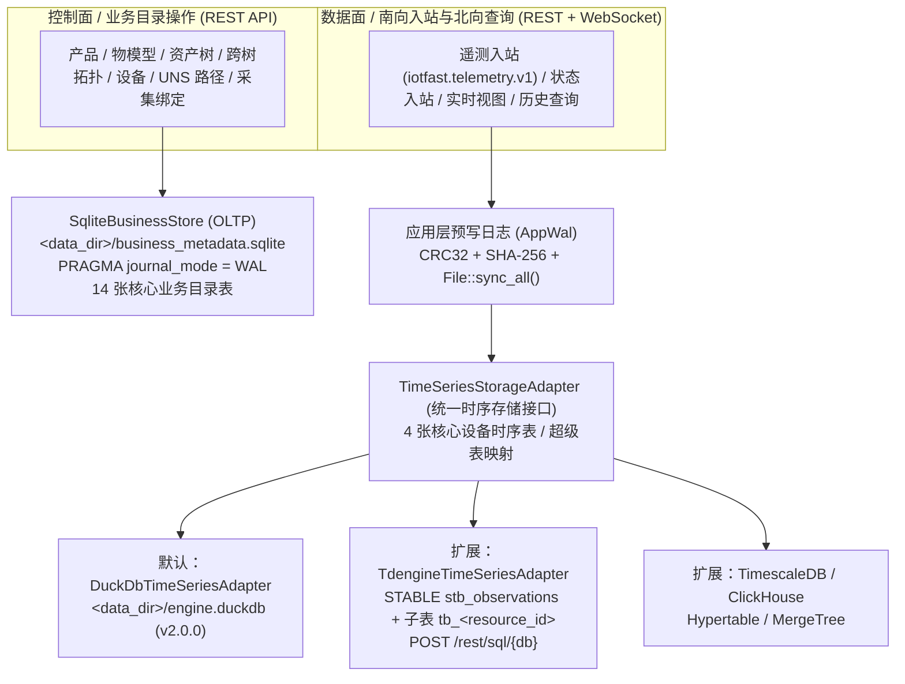

# 业务元数据（SQLite）与设备时序数据（DuckDB / TDengine）分层存储架构验证报告

状态：2026-11-11 本地受控闭环已验证（对应决策台账 [`SD-STORAGE-01`](../specification-decisions.md) 与 [`SD-STORAGE-02`](../specification-decisions.md)）。

> **事实与边界声明（含 `SD-STORAGE-02` 二期范围确认）**：本报告记录 `iotfast-thing-engine` 中业务/控制面元数据（嵌入式 SQLite WAL，14 张 OLTP 业务目录表）与设备时序数据（可插拔 `TimeSeriesStorageAdapter`，默认嵌入式 DuckDB `v2.0.0`，原生扩展支持 TDengine 超级表/子表、TimescaleDB 与 ClickHouse）及单实例目录锁（`D01.2`）、在线一致性快照备份与隔离沙箱恢复校验（`D10.1`）的代码实现与自动化验证证据。本地测试已验证 SQLite 独立灾备恢复、DuckDB 时序落库、TDengine `STABLE`/Subtable SQL 生成及 `/rest/sql/{db}` HTTP REST 线协议交互、`ST-02` 能力握手、`ST-04` 连续检查点及在线快照备份沙箱恢复；根据用户确认决议 `SD-STORAGE-02`（2026-11-11），对接外部生产级 `taosd`（TDengine）集群的实连验收（`ST-06`）、跨库回填迁移（`ST-07`）与存量外部时序库直读映射（`P1-REF-READ`）明确纳入下一期（二期）实施范围。

---

## 1. 架构概览（`SD-STORAGE-01`）

为避免将高频追加的设备遥测时序数据与强事务一致性的控制面业务目录耦合在同一存储模型中，引擎在存储层实施严格职责切分：



- **业务元数据权威存储（`SqliteBusinessStore`）**：源码位于 [`prototype/src/catalog/sqlite_store.rs`](../../../prototype/src/catalog/sqlite_store.rs)，直接通过系统 `libsqlite3` FFI 持久化至 `<data_dir>/business_metadata.sqlite`，启用 `WAL` 日志模式、`synchronous = NORMAL` 与 `foreign_keys = ON`。
- **设备时序可插拔适配（`TimeSeriesStorageAdapter`）**：源码位于 [`prototype/src/ingest/ts_adapter.rs`](../../../prototype/src/ingest/ts_adapter.rs)，定义统一时序写入、状态更新、最新值查询与历史分桶聚合查询下推接口。

---

## 2. 物理表切分矩阵

### 2.1 SQLite 业务元数据表（14 张 OLTP 目录表）

存储在 `<data_dir>/business_metadata.sqlite` 中，不包含任何高频设备遥测点值：

| 序号 | 表名 | 主键 / 唯一约束 | 存储内容与职责 |
|---:|---|---|---|
| 1 | `product` | `PRIMARY KEY (product_id)`, `UNIQUE (tenant_id, product_key)` | 产品定义与租户内唯一 `product_key` |
| 2 | `model_revision` | `PRIMARY KEY (model_revision_id)`, `UNIQUE (tenant_id, product_id, model_version)` | 物模型版本生命周期（`draft` / `published`）、`model_hash` 与发布时间 |
| 3 | `model_item` | `PRIMARY KEY (model_revision_id, identifier)` | 物模型属性定义、标量类型（`float64`/`int64`/`bool`/`text`）、工程单位与量程 |
| 4 | `asset` | `PRIMARY KEY (asset_id)`, `UNIQUE (tenant_id, asset_path)` | 多级资产树节点、父节点引用与规范化 `asset_path` |
| 5 | `device` | `PRIMARY KEY (device_id)`, `UNIQUE (tenant_id, device_key)` | 设备实例、挂载资产、当前激活的物模型版本/绑定版本与乐观锁 `revision` |
| 6 | `resource` | `PRIMARY KEY (resource_id)`, `UNIQUE (device_id, property)` | 稳定 `resource_id` 权威查表与当前 `canonical_uri`（`Q11`） |
| 7 | `resource_path` | `PRIMARY KEY (uri)` | UNS 路径状态（`canonical` / `redirected` / `retired`）与历史路径永久防抢占（`Q06`） |
| 8 | `source_gateway` | `PRIMARY KEY (tenant_id, source_id)` | 南向采集网关登记与连接状态 |
| 9 | `source_device_grant` | `PRIMARY KEY (tenant_id, source_id, device_id)` | 网关上报授权及 `[valid_from_ms, valid_to_ms)` 半开有效区间（`Q02`） |
| 10 | `binding_revision` | `PRIMARY KEY (binding_revision_id)` | 数据引用版本、归一化归属（默认 `gateway`）与 `config_hash`（`Q09`） |
| 11 | `point_binding` | `PRIMARY KEY (binding_revision_id, property)` | 动态寄存器采集点（`gateway_measurement`）与静态铭牌属性（`static_config`） |
| 12 | `asset_relation` | `PRIMARY KEY (relation_id)`, `UNIQUE (tenant_id, from_asset_id, relation_type, to_asset_id)` | 跨资产树逻辑拓扑关系（如 `FEEDS`、`BACKUP_FOR`、`MONITORS`） |
| 13 | `edge_adapter` | `PRIMARY KEY (adapter_id)` | 边缘协议适配器能力注册表（对应 `POST /v1/adapters`、`GET /v1/adapters`、`POST /v1/adapters/{adapter_id}:validate-binding`） |
| 14 | `derived_metric` | `PRIMARY KEY (metric_id)` | 物模型衍生指标定义表（OEE / 区间能耗 / 单位产品能耗公式与属性映射，对应 `POST /v1/derived-metrics`、`GET /v1/derived-metrics`、`POST /v1/derived-metrics/{metric_id}:evaluate`） |

**持久同步与冷启动恢复机制**：
- 每次控制面写操作完成后，引擎在单个 `BEGIN IMMEDIATE TRANSACTION` 事务内将目录状态同步至 `business_metadata.sqlite`。
- 当时序库文件（如 `engine.duckdb`）被清理、迁移或首次初始化时，`EngineRuntime::open` 自动调用 `SqliteBusinessStore::restore_to_catalog` 从 `business_metadata.sqlite` 恢复全部 14 张业务目录表（含边缘适配器能力声明 `edge_adapter` 与衍生指标定义 `derived_metric`）。

### 2.2 设备时序数据与投递状态表（4 张核心时序表 + 3 张 WAL/投递账本表）

默认由 `DuckDbTimeSeriesAdapter` 存储在 `<data_dir>/engine.duckdb` 中，并通过 `TimeSeriesStorageAdapter` 支持路由至 TDengine、TimescaleDB、ClickHouse 等外部时序引擎：

| 序号 | 表名 | 主键 | 存储内容与职责 |
|---:|---|---|---|
| 1 | `latest_value` | `PRIMARY KEY (resource_id)` | 每个设备属性的最新工程值、采样时间 `value_sampled_at_ms`、接收时间与 `resource_revision` |
| 2 | `point_quality_state` | `PRIMARY KEY (resource_id)` | 独立幂等域下的点位质量状态（`good` / `uncertain` / `bad`）与网关连接状态（`Q04` / `SC08`） |
| 3 | `last_persisted_value` | `PRIMARY KEY (resource_id)` | 死区（`deadband`）与心跳间隔（`heartbeat_ms`）过滤的上次落库基准 |
| 4 | `history_observation` | `PRIMARY KEY (observation_id)` | 历史遥测工程值明细（含 `source_at_ms`、`received_at_ms`、标量列、`quality`、`wal_position`） |
| 5 | `applied_message` | `PRIMARY KEY (tenant_id, source_id, source_epoch, message_id)` | 入站幂等去重、哈希防篡改与双维状态（`status` + `history_status`，`Q12`） |
| 6 | `wal_checkpoint` | `PRIMARY KEY (consumer_id)` | 应用层 WAL 连续消费水位线记录 |
| 7 | `storage_delivery_ledger` | `PRIMARY KEY (target_id, wal_seq)` | `ST-04` 多后端非连续投递状态机账本（跟踪 `committed` / `unknown` / `isolated_gap` 并计算连续前缀 checkpoint） |

---

## 3. TDengine 超级表（`STABLE`）与单资源子表（Subtable）适配设计

`TdengineTimeSeriesAdapter`（见 [`prototype/src/ingest/ts_adapter.rs`](../../../prototype/src/ingest/ts_adapter.rs)）遵循 TDengine“一采集点一子表、同类型共享超级表”的最佳实践，将 `iotfast-thing-engine` 的稳定 `resource_id` 映射为子表名 `tb_<sanitized_resource_id>`，将租户、设备、属性及模型/绑定版本映射为 `TAGS` 标签列。

### 3.1 超级表（`STABLE`）DDL

切换或初始化 `TdengineTimeSeriesAdapter` 时，自动生成并执行以下幂等 DDL：

```sql
CREATE DATABASE IF NOT EXISTS iotfast_tsdb PRECISION 'ms' KEEP 365;
CREATE STABLE IF NOT EXISTS iotfast_tsdb.stb_observations (
    ts TIMESTAMP,
    received_at TIMESTAMP,
    val_f64 DOUBLE,
    val_i64 BIGINT,
    val_bool BOOL,
    val_str NCHAR(256),
    unit_code NCHAR(32),
    quality NCHAR(16),
    source_seq NCHAR(64),
    observation_id NCHAR(64),
    replayed BOOL,
    wal_position NCHAR(64)
) TAGS (
    tenant_id NCHAR(64),
    resource_id NCHAR(128),
    device_id NCHAR(64),
    property NCHAR(64),
    model_revision_id NCHAR(64),
    binding_revision_id NCHAR(64)
);
```

### 3.2 子表自动建表与批量写入 DML

当遥测批次提交时，`build_insert_sql` 按点位 `resource_id` 构造 TDengine `INSERT INTO ... USING ... TAGS (...) VALUES (...)` 语句（若子表不存在，TDengine 自动基于超级表创建子表）：

```sql
INSERT INTO iotfast_tsdb.tb_res_pump_001_outlet_pressure
    USING iotfast_tsdb.stb_observations
    TAGS ('ten-8iic', 'res-pump-001-outlet-pressure', 'pump-001', 'outlet_pressure', 'pump-r1', 'bind-pump-001-r1')
    VALUES (20000, 20005, 1.72, NULL, NULL, '1.72', 'MPa', 'good', '2', 'obs-...', false, '0000000000000001:0000000000000000');
```

### 3.3 查询下推映射（`LAST_ROW` 与 `INTERVAL` 降采样）

| 查询类型 | `DuckDbTimeSeriesAdapter` SQL | `TdengineTimeSeriesAdapter` 下推 SQL |
|---|---|---|
| 最新值查询 | `SELECT resource_id, value_json, value_sampled_at_ms, received_at_ms, resource_revision FROM latest_value WHERE tenant_id = ? AND resource_id = ?` | `SELECT LAST_ROW(ts, val_f64, val_str, quality, model_revision_id, binding_revision_id) FROM iotfast_tsdb.stb_observations WHERE tenant_id = '...' AND resource_id = '...';` |
| 原始历史查询 (`raw`) | `SELECT observation_id, resource_id, source_at_ms, value_json, quality FROM history_observation WHERE ... ORDER BY source_at_ms ASC, resource_id ASC` | `SELECT ts, resource_id, val_f64, val_str, unit_code, quality, observation_id FROM iotfast_tsdb.stb_observations WHERE tenant_id = '...' AND resource_id IN (...) AND ts >= {start_ms} AND ts < {end_ms} ORDER BY ts ASC;` |
| 时间桶聚合 (`aggregate`) | `SELECT resource_id, ({start_ms} + ((source_at_ms - {start_ms}) / {b_ms}) * {b_ms}) AS bucket_start_ms, AVG(value_f64), MIN(value_f64), MAX(value_f64), COUNT(*) ... GROUP BY resource_id, bucket_start_ms` | `SELECT _wstart AS bucket_start_ms, resource_id, AVG(val_f64) AS avg_val, MIN(val_f64) AS min_val, MAX(val_f64) AS max_val, COUNT(*) AS sample_count FROM iotfast_tsdb.stb_observations WHERE ... PARTITION BY resource_id INTERVAL({b_ms}a) FILL(NONE);` |

### 3.4 运行时检查、切换、查询下推、`ST-02`/`ST-04`/凭据脱敏与 `D01.2`/`D10.1` 备份恢复接口

- **单实例目录锁与流纪元（`D01.2`）**：`EngineRuntime::open` 启动首步强制执行 `EngineConfig::validate()`（`iotfast_server` 默认采用 `EngineConfig::for_production` 水位配置），通过 POSIX `flock(LOCK_EX | LOCK_NB)` 独占锁定 `<data_dir>/engine.lock`（多进程并发双写同一目录立即返回 `409 VERSION_CONFLICT`），并在每次实例启动时分配全局唯一 `stream_epoch`（`se-<unix_ms>-<seq>`）。
- **凭据脱敏防线（`external-tsdb-reference-mapping.md` §3/§9）**：`GET /v1/storage/status` 与 `POST /v1/storage/timeseries-adapter` 返回的 `tdengine_config.password` 永远强制脱敏为 `"***REDACTED***"`，严禁在北向/管理面响应中回显明文密码。
- `GET /v1/storage/status`：返回 `StorageArchitectureStatus`，包含：
  - `business_metadata_store`：`engine: "sqlite"`、`sqlite_version`、`db_path`（`<data_dir>/business_metadata.sqlite`）、`journal_mode: "wal"`、14 张表列表与实时 `row_counts`。
  - `device_timeseries_store`：`active_backend`（`"duckdb"` / `"tdengine"` / `"timescaledb"` / `"clickhouse"`）、`supported_backends`、脱敏后的 `tdengine_config`（`password: "***REDACTED***"`）、`tdengine_super_table_ddl`、`recent_tdengine_sql_log` 及 4 张核心时序表 `row_counts`。
- `POST /v1/storage/timeseries-adapter`：在线切换设备时序存储适配器（支持 `"duckdb"`、`"tdengine"`、`"timescaledb"`、`"clickhouse"`；当传入 `"strict_lossless": true` 时执行 `ST-02` 能力门禁校验，若目标后端不满足 `same_timestamp_distinct == "supported"` 且 `exact_id_roundtrip == "supported"`，则拒绝切换并返回 `422 CAPABILITY_UNSUPPORTED` / `LOSSLESS_SAME_TIMESTAMP_UNSUPPORTED`）。
- `POST /v1/storage/query-plan`：传入 `resource_ids`、`start_ms`、`end_ms` 与可选 `bucket_ms`，返回当前激活时序后端对应的原生 SQL 查询下推计划（`DuckDB` / `TDengine INTERVAL` / `TimescaleDB time_bucket` / `ClickHouse toStartOfInterval`）。
- `GET /v1/storage/capabilities`（`ST-02` 能力矩阵握手）：返回各时序后端（`duckdb`、`tdengine`、`timescaledb`、`clickhouse`）的 `StorageCapabilityProfile`（含 `same_timestamp_distinct`、`exact_id_roundtrip`、`transactional_batch_atomic`、`out_of_order_ingest`、`downsampling_pushdown` 等能力枚举）。
- `GET /v1/storage/checkpoints` 与 `POST /v1/storage/checkpoints:reconcile`（`ST-04` 非连续投递空洞与连续前缀水位状态机）：严格按连续前缀推进 `contiguous_checkpoint_seq`（例如 `101 committed + 102 unknown + 103 committed => contiguous_checkpoint_seq = 101`，绝不越过未决空洞 `102` 推进水位，直至通过 `:reconcile` 执行 `mark_committed` 或 `isolate_gap` 显式收敛后才推进至 `103`）。
- `POST /v1/storage/backups`、`GET /v1/storage/backups` 与 `POST /v1/storage/backups/{backup_id}:verify`（`D10.1` 在线一致性快照备份与隔离沙箱恢复演练）：通过 SQLite `VACUUM INTO` + DuckDB `CHECKPOINT` + `AppWal` 段拷贝生成带全文件 SHA-256 清单的 `backup_manifest.json`，并在临时隔离目录启动独立 `EngineRuntime` 重放 WAL、逐表核对 14 张 SQLite 业务表与 DuckDB 历史/最新值条数及 SHA-256 摘要（篡改单字节即检出失败）。

---

## 4. 自动化测试与验证证据

### 4.1 专项集成测试：`prototype/tests/storage_sqlite_duckdb_tdengine_test.rs`（4 项测试全部通过）

1. **`sqlite_saves_business_metadata_duckdb_saves_device_data_and_tdengine_adapter_executes`**：
   - **业务元数据持久化至 SQLite WAL 与默认 DuckDB 遥测入站**：创建产品 `prod-pump`、物模型 `pump-r1`（含动态属性 `outlet_pressure` 与静态属性 `rated_power`）、资产 `asset-room-1`、设备 `pump-001` 及绑定 `bind-pump-001-r1`。断言 `status.business_metadata_store.engine == "sqlite"`、`journal_mode == "wal"`，且 `<data_dir>/business_metadata.sqlite` 物理文件存在，`product=1`、`device=1`、`resource=2`、`point_binding=2`；写入遥测样本 `msg-001`（`outlet_pressure = 1.55 MPa`），断言默认 `active_backend == "duckdb"` 返回 `accepted_durable`。
   - **物理删除 `engine.duckdb` 后从 SQLite 独立恢复业务目录**：关闭运行时并执行 `std::fs::remove_file(cfg.db_path())` 彻底删除 `engine.duckdb`，仅保留 `business_metadata.sqlite`。重新打开 `EngineRuntime::open(cfg)`，断言 `AssetUnsService::get_device` 与 `get_device_view` 完整恢复 `pump-001`、2 个稳定 `resource_id`、激活绑定 `bind-pump-001-r1` 及静态铭牌属性 `rated_power = 45.0 kW`（`binding_state = "bound_static"`）。
   - **切换至 `TdengineTimeSeriesAdapter` 并验证 `STABLE` + 子表 DML 及 HTTP REST 线协议**：调用 `rt.switch_to_tdengine_adapter(td_cfg)` 切换至 TDengine 适配器，写入遥测样本 `msg-002`（`outlet_pressure = 1.72 MPa`）。断言 `recent_tdengine_sql_log` 生成 `CREATE STABLE IF NOT EXISTS iotfast_tsdb.stb_observations ...` 与 `INSERT INTO iotfast_tsdb.tb_res_pump_001_outlet_pressure USING iotfast_tsdb.stb_observations TAGS ('ten-8iic', ...)`；使用 `send_tdengine_http_over_stream` 验证 `POST /rest/sql/iotfast_tsdb HTTP/1.1`、`Authorization: Basic ...` 请求头及 TDengine `{"code":0,"column_meta":[["affected_rows","INT",4]],"data":[[1]],"rows":1}` 响应解析，并断言聚合查询下推包含 `PARTITION BY resource_id INTERVAL(60000a) FILL(NONE)`。
   - **扩展验证 `TimescaleDB` 与 `ClickHouse` 适配器**：切换至 `timescaledb` 验证 `create_hypertable('history_observation', 'ts')` 与 `time_bucket(...)` 聚合下推；切换至 `clickhouse` 验证 `ENGINE = ReplacingMergeTree()` 与 `toStartOfInterval(...)` 聚合下推。
2. **`http_storage_status_timeseries_adapter_switch_and_query_plan_work`**：
   - 通过 HTTP REST 接口验证 `GET /v1/storage/status`、`POST /v1/storage/timeseries-adapter` 在线切换后端，以及 `POST /v1/storage/query-plan` 生成原生聚合下推 SQL。
3. **`st02_capability_handshake_password_redaction_and_st04_checkpoint_hole_state_machine_work`**：
   - 验证 `tdengine_config.password == "***REDACTED***"` 脱敏、`GET /v1/storage/capabilities` 与 `strict_lossless: true` 对不支持同毫秒多点区分后端的 `422 CAPABILITY_UNSUPPORTED` 拦截（`ST-02`），以及 `101 committed + 102 unknown + 103 committed => checkpoint 101` 直至 `102` 被 `mark_committed` / `isolate_gap` 对账后推进至 `103` 的非连续投递状态机（`ST-04`）。
4. **`d01_single_instance_lock_stream_epoch_and_d10_consistent_backup_restore_verify_work`**：
   - 验证 `D01.2` 单实例目录锁（同一 `data_dir` 并发 `EngineRuntime::open` 立即拒绝并返回 `409 VERSION_CONFLICT`）、每次启动分配唯一递增 `stream_epoch`（`se-<unix_ms>-<seq>`），以及 `D10.1` `POST /v1/storage/backups`、`GET /v1/storage/backups`、`POST /v1/storage/backups/{id}:verify` 在线一致性快照备份、隔离沙箱恢复核对与单字节篡改 SHA-256 拦截。

### 4.2 端到端演示脚本验证：`scripts/mvp-thing-model-demo.py`

端到端演示脚本在完成控制面建模、资产绑定与实时遥测入站后，通过 HTTP 调用：
- `GET /v1/storage/status`：校验 `business_metadata_store.engine == "sqlite"` 且 `journal_mode == "wal"`（14 张业务表），以及 `device_timeseries_store.active_backend == "duckdb"`。
- `POST /v1/storage/timeseries-adapter`：在线切换至 `"tdengine"`，校验 `tdengine_super_table_ddl` 生成且 `tdengine_config.password == "***REDACTED***"`，随后切回 `"duckdb"` 恢复默认配置。
- `GET /v1/storage/capabilities` 与 `GET /v1/storage/checkpoints`：校验 `ST-02` 能力矩阵握手与 `ST-04` 连续前缀投递水位状态。
- `POST /v1/storage/backups` 与 `POST /v1/storage/backups/bkp-demo-01:verify`：创建在线一致性快照备份并在隔离沙箱中验证 `verified == True`（`D10.1`）。

### 4.3 复现命令

```bash
# 运行存储分层与 TDengine 适配器专项集成测试
cargo test --locked --manifest-path prototype/Cargo.toml --test storage_sqlite_duckdb_tdengine_test

# 运行包含存储状态与适配器切换验证的端到端演示脚本
python3 scripts/mvp-thing-model-demo.py
```
