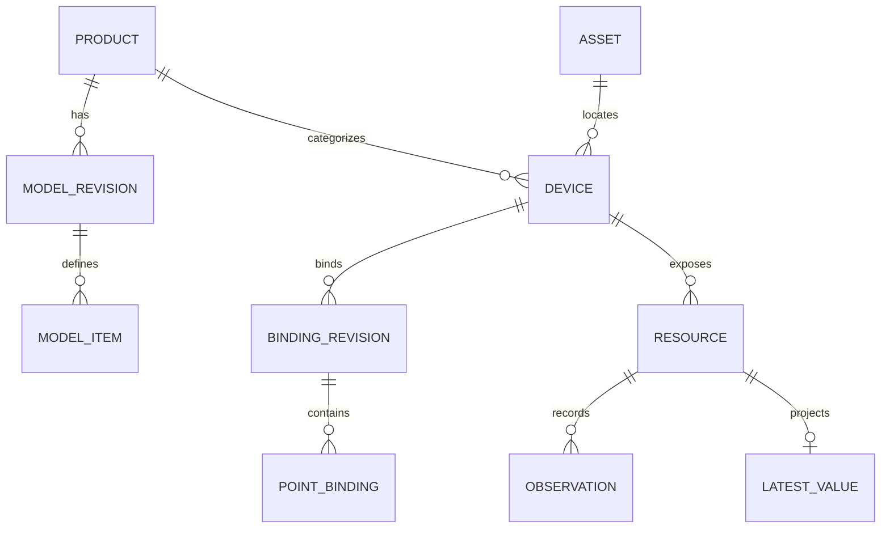

# 工业物模型引擎数据库表结构设计

> **职责边界更新**：本引擎定位为设备业务数据模型与标准数据服务；用户 / 角色 / 菜单、业务权限、审批、告警与物理控制属于上层。引擎保留服务身份验证及可信数据范围隔离。原文相关内容为历史候选，不构成本引擎实施范围，详见 [职责与模型规范](../architecture/data-engine-scope.md)。

状态：研发设计草案，未执行 DDL 或数据库兼容性测试。基线为 [总体设计](../architecture/design-specification.md)、[时序数据库设计](timeseries-storage.md) 和 [存储适配器契约](storage-adapter-contract.md)。本文件的表名、字段类型、索引和事务是**目标逻辑设计**，物理 DDL 必须通过锁定版本的实测与评审后生成。与总体设计第二部分有冲突时先登记并协调。

## 1. 设计原则与部署

单机首期目标：同一 Rust 进程管理本地 DuckDB 2.0.0 数据文件，存储元数据、latest 投影、历史记录及可靠投递元数据；应用层 WAL 位于独立持久文件。数据量与故障验证后可拆分控制面和历史目标，但跨数据库 / 文件不假设原子事务。

SQL 表不代替应用 WAL：accepted_durable 的确认边界是 WAL 记录同步到所配置的持久层；DuckDB 查询到记录是另一个提交阶段。外部 TSDB 仅承载可适配的历史投影，设备模型与权限等控制面仍由引擎维护。默认无租户删除级联，产品 / 模型 / 设备采用禁用或归档。

逻辑通用类型：ID=受限 UTF-8 字符串；TS=UTC Unix 毫秒 BIGINT；JSON=结构化值（实际类型须依数据库验证）；BOOL；TEXT；BYTES。标注 ? 为允许空；所有表的 tenant_id 由可信身份上下文生成，不接受客户端直接决定。所有例子里的 ID 与地址仅演示。

## 2. 关系总览

关系为逻辑约束，并不承诺每个外部 TSDB 具有外键。tenant_id 应包含在所有跨表的业务引用及查询条件中，防止不同租户产生越权关联；数据库内外键和唯一约束能否高效支持，须实测。

## 3. 产品与物模型域

### 3.1 product：产品

| 字段 | 类型 | 约束与说明 |
|---|---|---|
| tenant_id | ID | 必填，租户 |
| product_id | ID | PK，服务端稳定 ID |
| product_key | TEXT | 同租户唯一、不可随意复用 |
| name / category / description | TEXT / TEXT? / TEXT? | 显示名、分类、说明 |
| status | TEXT | active / disabled |
| revision | BIGINT | 乐观并发版本 |
| created_at_ms / updated_at_ms | TS | 创建 / 更新 |

约束 UNIQUE(tenant_id, product_key)；product_key 不作为设备外键，禁用产品不删除已关联设备和历史。

### 3.2 model_revision：产品模型快照

tenant_id ID、model_revision_id ID PK、product_id ID、model_version TEXT、spec_version TEXT、state TEXT、model_body JSON、content_hash TEXT、created_by ID、created_at_ms TS、published_at_ms TS?、deprecated_at_ms TS?。UNIQUE(tenant_id, product_id, model_version)；关联 product 属于同一租户。state 为 draft / published / deprecated / retired；发布后 body 和 hash 不可修改；新版本另建行。版本比较、兼容性报告和设备升级需要服务层事务验证。

### 3.3 model_item：模型能力索引

tenant_id ID、model_revision_id ID、kind TEXT、identifier TEXT、name TEXT、description TEXT?、data_type JSON、access_mode TEXT?、semantic JSON?、unit JSON?、item_spec JSON、ordinal INTEGER。PK(model_revision_id, kind, identifier)，kind=property / service / event；所有字段均以发布快照 model_body 为权威，索引在发布事务中从同一快照生成，禁止独立编辑。变更排序不改变 identifier。嵌套 struct / array、服务参数和事件 payload 存 item_spec，不强行展开为历史物理列。

发布时检查属性 identifier 是否唯一、类型及约束合法、item 索引与 body 一致；不完整不能发布。实际数据库能否在同一事务完成全量替换和不可变约束待验证。

## 4. 资产、设备与 UNS

### 4.1 asset：资产树

tenant_id ID、asset_id ID PK、parent_asset_id ID?、slug TEXT、name TEXT、asset_type TEXT、revision BIGINT、created_at_ms TS、updated_at_ms TS。唯一性为同租户同一 parent 下 slug 唯一；根节点 parent 为 NULL 时需采用可验证的唯一方案，不能仅依赖普通 NULL 唯一约束。服务端事务检查无环、父节点存在且同租户。支持厂区、产线等自定义层级。

### 4.2 device：设备实例

tenant_id ID、device_id ID PK、product_id ID、model_revision_id ID、asset_id ID、device_key TEXT、name TEXT、lifecycle TEXT、revision BIGINT、created_at_ms TS、updated_at_ms TS。UNIQUE(tenant_id, device_key)；绑定的模型须属于该产品且已发布。设备移动变更 asset_id / 资源路径，不更改 device_id。可接入网关与否由来源授权和绑定确定。

### 4.3 resource：可寻址点位与服务

tenant_id ID、resource_id ID PK、device_id ID、kind TEXT、identifier TEXT、created_at_ms TS、retired_at_ms TS?。UNIQUE(tenant_id, device_id, kind, identifier)；代表稳定逻辑资源，具体属性类型取设备使用的模型版本与 model_item。需要防止 identifier 删除后复用造成历史误认；模型破坏性变更应经兼容检查，必要时创建新 resource_id，而不是覆盖旧含义。

### 4.4 resource_path：当前路径及历史

tenant_id ID、path_id ID PK、resource_id ID、canonical_uri TEXT、valid_from_ms TS、valid_to_ms TS?、redirect_until_ms TS?、path_state TEXT。一个资源仅允许一条当前 canonical 路径，同租户一个当前 URI 仅属于一个资源；通过事务 + 约束实现并验证，不能只依赖内存检查。历史 URI 在允许的保留 / 跳转期间不可被新资源占用。重命名 / 移动以元数据事务关闭旧记录、创建新记录；历史按稳定 resource_id 和目录版本解释。非当前路径是否自动跳转必须鉴权。

## 5. 协议目录、网关和绑定

### 5.1 protocol_definition：协议定义

protocol_id ID PK、protocol_key TEXT、driver_version TEXT、name TEXT、config_schema JSON、point_schema JSON、capabilities JSON、status TEXT；UNIQUE(protocol_key, driver_version)。仅保存描述与参数约束，不保存现场连接密钥；每个版本明确已实现 / 规划状态。

### 5.2 source_gateway：数据来源

tenant_id ID、source_id ID PK、name TEXT、auth_identity_ref TEXT、status TEXT、last_seen_ms TS?、created_at_ms TS。授权关系由 source_device_grant 表表示：tenant_id、source_id、device_id、grant_state、valid_from_ms、valid_to_ms?；PK(tenant_id, source_id, device_id, valid_from_ms)。以服务端认证主体解析 source_id；不直接信任消息中的 source_id。

### 5.3 channel：通道配置

tenant_id ID、channel_id ID PK、source_id ID、protocol_id ID、name TEXT、connection_config JSON、credential_ref TEXT?、status TEXT、config_revision BIGINT、updated_at_ms TS。配置可包含非密钥的主机 / 端口引用，凭据只保存安全存储引用。通道配置变化需要版本及审计，实际设备连通性与授权另行验证。

### 5.4 binding_revision：设备绑定快照

tenant_id ID、binding_revision_id ID PK、device_id ID、model_revision_id ID、source_id ID、revision_no BIGINT、state TEXT、config_hash TEXT、normalization_owner TEXT、created_at_ms TS、activated_at_ms TS?、superseded_at_ms TS?、gateway_ack JSON?。UNIQUE(tenant_id, device_id, revision_no)；同设备至多一个 active。P0 normalization_owner=gateway；ready 并不代表设备已联通。激活需要条件版本、网关 ACK 或人工停采窗口；如无可靠生效时钟，旧版本迟到数据无法证明时隔离而非猜测。

### 5.5 point_binding：点位绑定

tenant_id ID、binding_revision_id ID、property_identifier TEXT、channel_id ID、protocol_address JSON、raw_type TEXT、byte_order TEXT?、word_order TEXT?、transform_spec JSON、sample_interval_ms BIGINT、enabled BOOL。PK(binding_revision_id, property_identifier)；引用模型对应的 property。Modbus 地址须明确零基、功能码、寄存器数量、站号与字节 / 字顺序；transform_spec 如 factor 0.1 是网关工程量转换的配置与追溯信息，引擎不再次换算。

## 6. 实时状态与质量

### 6.1 latest_value：最新测量投影

tenant_id ID、resource_id ID PK、observation_id ID、value_type TEXT、value_f64 DOUBLE?、value_i64 BIGINT?、value_bool BOOL?、value_text TEXT?、value_json JSON?、value_sampled_at_ms TS、received_at_ms TS、source_time_origin TEXT、source_id ID、source_epoch TEXT、source_seq TEXT、model_revision_id ID、binding_revision_id ID、revision BIGINT、history_status TEXT。值列按 value_type 恰有一个合法值；int64 对 JSON 客户端的编码规则与底层 BIGINT 存储区分。乱序比较规则按总体设计 22 节，旧 epoch 补传不得错误覆盖新值。

### 6.2 point_quality_state：质量 / 新鲜度

tenant_id ID、resource_id ID PK、quality_state TEXT、quality_reason TEXT?、source_quality_code TEXT?、quality_observed_at_ms TS、stale_after_ms BIGINT?、source_connection_state TEXT、revision BIGINT。故障更新质量不产生新 value_sampled_at；过期可按当前时间计算或通过状态事件更新，但服务需保留原因与时间。latest 与 quality 分表是逻辑设计；为实现一致快照需同事务 / 同有序状态域或明确版本屏障并经测试。

无测量时不创建虚假 0；读取时返回 value=null、quality=unknown。质量变化历史使用 quality_event 表（tenant_id、event_id PK、resource_id、state、reason、observed_at_ms、source_id），不能写成伪造的新数值观测。

## 7. 历史观测

### 7.1 history_observation：统一逻辑行

| 字段 | 类型 | 说明 |
|---|---|---|
| tenant_id | ID | 租户 |
| observation_id | ID | PK 或经过验证的唯一约束；首次 WAL 写入前生成并固定 |
| resource_id / device_id / property_identifier | ID / ID / TEXT | 稳定资源和点位 |
| model_revision_id / binding_revision_id | ID | 当时版本，不随当前配置变更 |
| source_id / source_epoch / source_seq | ID / TEXT / TEXT | 来源与顺序；source_seq 按数值语义比较 |
| source_at_ms / received_at_ms | TS | 原采样时间与服务接收时间 |
| source_time_origin | TEXT | 设备 / 网关等来源，词表待冻结 |
| value_type | TEXT | float64 / int64 / bool / text / json |
| value_f64 / value_i64 / value_bool / value_text / value_json | DOUBLE? / BIGINT? / BOOL? / TEXT? / JSON? | 仅一个值列有效，NULL 不代表 0 |
| quality_state / quality_reason / source_quality_code | TEXT / TEXT? / TEXT? | 标准与原始质量 |
| replayed | BOOL | 补传标记，不改变质量 |
| ingested_wal_position | TEXT | WAL 定位，编码待冻结 |

一个 message 包含多个 property 时，每个 property 各有不同 observation_id；相同资源与采样毫秒可存在多条。P0 可按 value_type 分成 numeric / integer / bool / text / json 多张物理表，但只能在能保留所有字段、稳定 ID 和按资源统一查询的前提下使用；跨表查询应保留 typed value 且经过测试。该逻辑行不保证所有时序库能无损表达，目标必须提供能力报告。

建议查询索引候选：(tenant_id, resource_id, source_at_ms, observation_id)、(tenant_id, device_id, source_at_ms)、observation_id 唯一性；具体 DuckDB 索引、排序、分区 / 表布局由真实查询和写入测试确定。查询为 [start,end)，排序 (source_at_ms, observation_id)。大规模实际点位 / 写入条件未知，不能以本表假设推断性能。

### 7.2 last_persisted_value：死区 / 心跳基准

tenant_id ID、resource_id ID PK、last_observation_id ID、last_value JSON、last_persisted_at_ms TS、quality_state TEXT、policy_revision ID。历史策略判断基于工程值；该基准、历史写入及消息应用标记在同一 DuckDB 事务中更新，重放得到相同结果。无历史新增时也须完成消息应用标记；质量变化事件不能被死区吞掉。

## 8. 可靠接收、去重与同步

### 8.1 applied_message：已应用消息

tenant_id ID、source_id ID、source_epoch TEXT、message_id TEXT、payload_hash TEXT、ingest_id ID、wal_position TEXT、applied_at_ms TS、outcome TEXT。PK(tenant_id, source_id, source_epoch, message_id)，UNIQUE(tenant_id, ingest_id)。同 key 相同 hash 返回已有 ingest_id，不同 hash 返回冲突。此表用于 DuckDB 已应用判定；WAL 已同步但事务未应用时仍需要恢复 WAL 内去重索引。并发同 key 必须在入站阶段协调，避免不同消息竞争生成双重 durable ACK。

### 8.2 ingest_status：入站状态查询

tenant_id ID、ingest_id ID PK、message_key JSON、acceptance TEXT、wal_position TEXT?、history_status TEXT、error_code TEXT?、created_at_ms TS、updated_at_ms TS、expires_at_ms TS?。durable / volatile 表示接收边界；history_status=pending / committed / failed 不等同远端。状态记录存活时间和 WAL 清理规则必须与最大重试窗口一致；字段取值及失败恢复待契约冻结。

### 8.3 storage_target：存储目标

tenant_id ID、target_id ID PK、kind TEXT、name TEXT、config_revision BIGINT、connection_ref TEXT?、required BOOL、status TEXT、capability_snapshot JSON、checked_at_ms TS?、created_at_ms TS。capability_snapshot 明确数据库 / 驱动版本、实测证据和过期条件；本地 DuckDB 也对应一个 target。敏感凭据不得存入该表。

### 8.4 delivery_state：每目标投递明细

tenant_id ID、target_id ID、observation_id ID、wal_position TEXT、batch_id ID?、payload_hash TEXT、state TEXT、attempt_count INTEGER、last_error_code TEXT?、next_retry_at_ms TS?、updated_at_ms TS。PK(tenant_id, target_id, observation_id)。状态 pending / inflight / committed / retryable / permanent_rejected / unknown；重启 inflight 转 unknown。可按日志区间做压缩，但不得牺牲中间空洞 / 已完成记录的持久性。高频每点每目标一行的空间与写放大必须实测，P1 可使用分段完成位图等经验证的实现替代，保持语义不变。

### 8.5 target_checkpoint 与 delivery_gap

target_checkpoint：tenant_id ID、target_id ID、stream_id ID、contiguous_wal_position TEXT、revision BIGINT、updated_at_ms TS；PK(tenant_id, target_id, stream_id)。位置是日志记录身份 / 偏移结构，比较 / 分段规则明确后才可持久编码，不能按任意字符串字典序比较。

delivery_gap：tenant_id ID、gap_id ID PK、target_id ID、observation_id ID、wal_position TEXT、reason TEXT、decision TEXT、approved_by ID?、created_at_ms TS、closed_at_ms TS?。只有显式授权的隔离 / 跳过产生 gap，必须在查询和运维界面显示。例：101 committed，102 unknown，103 committed，则连续 checkpoint 至多 101；保留 103 完成状态，102 解决或经授权隔离并披露后才可推进。

## 9. 事件、控制和审计（后续阶段）

- device_event：tenant_id、event_id PK、device_id、resource_id、model_revision_id、event_identifier、payload JSON、occurred_at_ms、quality；设备事件不是告警闭环。
- command：tenant_id、command_id PK、device_id、service_identifier、request_hash、idempotency_key、principal_id、model_revision_id、binding_revision_id、status、created_at_ms、expires_at_ms、result JSON?；幂等唯一域为租户 + 主体 + 设备 / 动作 + key。
- command_transition：tenant_id、transition_id PK、command_id、from_state、to_state、reason、created_at_ms；状态变化不可伪装为物理动作完成。
- command_confirmation：tenant_id、confirmation_id PK、command_id、request_hash、approver_id、expires_at_ms、consumed_at_ms?、status；凭据 / 原始令牌不明文落库；一次性消费须事务保护。
- audit_log：tenant_id、audit_id PK、principal_id、action、target_type、target_id、before_hash、after_hash、result、occurred_at_ms、request_id；不保存密码 / 密钥。

上述为扩展设计，真实控制不属于只读 MVP。报警规则、告警实例 / 确认与关闭生命周期属于独立模块，尚未在此定义为已完成。

## 10. 完整示例与入库过程

回流焊炉产品 product_id=p1、模型 revision=m1；产线资产=a1、设备=d1；一温区属性 resource=r1、网关=s1、绑定版本=b1。某 Modbus 配置寄存器原始值 2456，网关按已确认倍率 0.1 上报工程值 245.6。

1. model_revision(m1) 和 model_item(m1, property, zone1_temp) 已发布，device(d1) 引用 m1；resource(r1) 标识该属性。
2. binding_revision(b1) active；point_binding 声明地址、raw_type 和转换规则。源 s1 必须获授权。
3. 引擎校验整个消息，分配稳定 observation_id=o1 并追加 WAL；达到配置同步边界后可返回 accepted_durable。
4. 历史消费者在单一 DuckDB 事务中执行 applied_message 判重、历史 / 死区基准和应用标记；事务提交后更新对应 checkpoint。
5. latest_value 写入 245.6，并保留采样时间；若稍后连接断开，更新 point_quality_state 为 bad，不把旧值当作新采样。
6. 若 external target 启用，其 delivery_state 是独立结果；本地已提交但外部 pending 时查询必须展示同步差异。

## 11. 事务、一致性与恢复边界

| 操作 | 目标事务 / 边界 | 异常处理 |
|---|---|---|
| 发布物模型 | model_revision 与 model_item 同一数据库事务 | 失败全部回滚；已发布不可原地覆盖 |
| 绑定激活 | 元数据条件更新 + 当前绑定约束 | 网关 ACK 不与数据库原子；重启后重新对账 |
| durable 接收 | WAL 写入和同步 | 不能以 DuckDB 事务提交代替 ACK 语义 |
| 应用历史 | applied_message + history + 死区基准同一 DuckDB 事务 | DB 已提交、checkpoint 未更新时以 applied_message 判重 |
| latest 更新 | 单资源有序投影；必要时与质量采用一致状态版本 | 重启可从持久状态 / WAL 恢复；历史与实时可暂时不一致 |
| 外部库投递 | 目标自身提交 + 本地投递状态 | 非分布式原子事务；超时 unknown，依据能力重试 / 对账 |

若元数据、历史拆到两个 DuckDB 文件，这些跨文件操作不得被标记为单事务；如涉及 WAL 或外部 TSDB，需单独定义恢复状态机。DuckDB 索引 / 约束 / 并发具体行为须在目标版本验证。

## 12. 保留、安全与容量

元数据与引用版本按历史保留策略保留；不可先删模型使旧历史无法解释。历史保留、WAL 大小 / 恢复时间及 target 去重窗口由项目指标决定。已 durable ACK 且必需目标尚未完成的数据不可静默删除；磁盘达硬水位应背压。备份需覆盖一致的数据库、WAL、检查点和目录快照，恢复时按实测方案验证；不能仅复制正在写入的文件就声称备份一致。

所有外部库连接使用独立授权和凭据引用；日志 / 样例不能带客户地址、密码或生产数据。多租户查询须先授权再访问物理表，复合索引仅优化访问，不替代授权。

容量预估模板：日观测条数 = 设备数 × 每设备属性数 × 平均每点每日持久条数；按有效变化率、心跳、时间分布单独计算，不能简单把采样数等同存储数。日空间 = 实测每观测总字节 × 日观测数 + 索引 / WAL / 复制开销；不同数据库压缩、JSON、索引和备份开销必须实测。远端断网容量 = 峰值持久字节速率 × 最大断网时长 × 安全余量；恢复吞吐必须大于持续入站速率才能追平。

## 13. 表创建与验证顺序

P0：product、model_revision、model_item → asset / device / resource / resource_path → protocol_definition / source_gateway / source_device_grant / channel / binding_revision / point_binding → latest_value / point_quality_state / quality_event → history_observation / last_persisted_value → applied_message / ingest_status / storage_target / delivery_state / target_checkpoint / delivery_gap。command / audit 相关结构按对应功能范围增量加入，鉴权和必要审计不能被推迟。

每个表完成前确认：唯一键与租户关联、NULL 约束、版本和迁移脚本、事务原子性、并发和恢复、关键查询计划、备份恢复，以及真实数据库版本。完整测试参考适配器 A01–A10 和总体设计 T01–T10；尚未运行的测试必须标记未验证。此文不是最终可直接部署的 DDL 或性能承诺。
