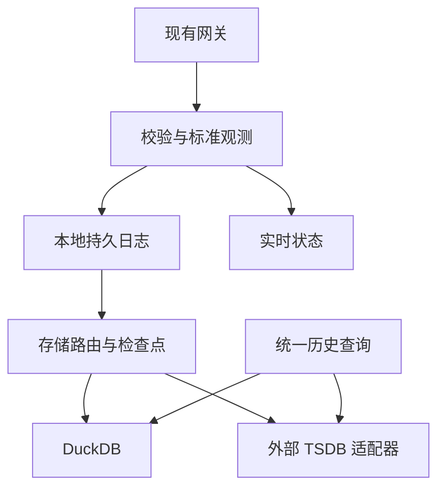

# 时序数据库接入与数据一致性设计

状态：设计草案；未实现或实际联调。本文细化 [总体设计第 10、23–24 节](../architecture/design-specification.md)，不改变 DuckDB 2.0.0 为默认目标的要求。版本、特性和性能以具体版本的实测报告为准。

## 1. 目标与边界

Rust 引擎向组态、SCADA、报表和 AI 提供统一的资源、历史查询和数据质量接口；后端可选择嵌入式 DuckDB，或通过独立适配器连接 TDengine、TimescaleDB、InfluxDB 等时序库。不同数据库的写入、重复数据和查询能力不完全相同，适配器必须声明并实测；不能假设切换连接字符串即可保证语义等价。

产品 / 模型、设备、绑定、资源目录、鉴权和命令审计属于控制面；时序库仅作为历史数据后端，不替代这些管理能力。设备 latest 由引擎维护，历史写入进度单独显示。驱动首期作为 Rust 进程内的编译期适配模块，动态装载第三方二进制插件不属于首版承诺。

## 2. 逻辑架构

图示为逻辑结构，实际启用的目标由模式决定。WAL 接受确认与各数据库写入确认必须分别报告。

## 3. 存储模式与明确保证

| 模式 | 本地保存 | 历史主查询来源 | 发送端收到 durable ACK 的条件 | 外部不可用 |
|---|---|---|---|---|
| local | WAL + DuckDB | DuckDB | 本地 WAL 达同步边界 | 不涉及 |
| remote-primary | WAL；可选本地 DuckDB 影子副本 | 外部 TSDB | 本地 WAL 达同步边界，响应明确 remote=pending | 留在本地队列并重试，超出限额拒绝新可靠请求 |
| dual | WAL + DuckDB + 外部 TSDB | 默认 DuckDB，可选指定外部 | 本地 WAL 达同步边界；响应列出两侧状态 | 每个目标独立重试，不假设跨库事务 |

上述 durable ACK **只表示本地持久接收**；不能解读为远端提交，也不保证节点永久损坏后的多副本存活。外部应用可查询各目标的 pending / committed / retrying / failed / unknown。若业务要求外部提交后才确认，单独选择 remote-confirmed 响应策略，且客户端需容忍超时后结果未知；连接故障时不可虚报远端成功。

每目标维护独立持久 checkpoint，WAL 回收取决于所有必需目标已完成；可选目标被跳过或移除必须由管理员显式决策并记录数据缺口。远端确认后服务在持久化 checkpoint 前崩溃会重复写，因此必须先证明目标幂等或采用可验证去重；无法证明则标记“至少一次、可能重复 / 冲突”，禁止声称端到端恰好一次。

## 4. Storage SPI 适配能力

存储接口定义为语义契约，非现成代码：初始化 / 健康检查、能力描述、schema 检查、批量写、按观测 ID 确认结果、历史查询、保留策略检查、关闭。统一返回可重试 / 永久错误 / 结果未知，超时不自动假设失败。批次支持逐条结果或显式声明整体成功 / 部分成功；无法确定的项目不得推进成功检查点。

能力描述包括版本、支持类型、时间精度、采样 ID 持久、幂等键范围、同时间多点、写入原子范围、乱序 / 迟到、批量上限、聚合、插值、稳定分页、时区 / 保留策略以及失败与查询一致性。所有值标记 supported / unsupported / conditional / unverified，附驱动及服务版本和证据。请求超出能力返回 CAPABILITY_UNSUPPORTED，不静默替代、丢弃质量字段或改写数据。

## 5. 统一数据记录与映射

统一逻辑观测字段：tenant_id、resource_id、device_id、property_id、model_revision_id、binding_revision_id、observation_id、source_id / epoch / seq、source_at_ms、received_at_ms、工程值、value_type、quality.state / reason、source_quality_code 与 replayed。时间以 UTC 毫秒作为契约；迁移到更高精度的库不得伪造采样时间。缺失和坏质量单独表示，数值字段不得用 0 代替 null。

| 后端 | 设计方向 | 重点验证 |
|---|---|---|
| DuckDB 2.0.0 | 单机默认；类型化长表、批量写和本地查询 | Rust crate / 引擎版本、Appender flush、事务及恢复 |
| TDengine | 独立适配器，按设备 / 属性及目标版本设计表结构 | 同时间写入、主键、批次局部失败、迟到数据与保留 |
| TimescaleDB | PostgreSQL 生态超表候选，类型化时间与 ID 列 | 分区 / 唯一约束、事务、索引和压缩 / 保留策略 |
| InfluxDB 3 | 按具体 Core / Clustered 版本评估行协议或可用写入接口 | 点身份、重复合并、乱序、类型和 tag 基数 |
| VictoriaMetrics | 后续可行性评估的指标后端 | 标签基数、数据类型、重复写入语义及完整观测字段 |

其中仅 DuckDB 是首阶段目标，其他均为规划，未声称已经支持。工厂 / 产线 / 设备位置可变，历史按稳定资源 ID 保存并通过带生效时间的目录关联；不要依赖可变路径作为唯一主键。具体索引 / tag 布局应以实际后端及查询性能测试决定。

## 6. 同毫秒采样与重复写风险

稳定 observation_id 属于逻辑身份；两个不同观测可能同 resource_id 与 source_at_ms，不能直接用该二元组当全局唯一键。每个后端必须通过实验证明：相同观测重传不会产生错误结果；不同 observation_id 即使同毫秒也可保留或明确拒绝。若后端不能保留，必须报告 LOSSLESS_SAME_TIMESTAMP_UNSUPPORTED，不能声称无损切换。

例如 InfluxDB 3 Core 文档将同表、tag 集和时间戳视为同一点并可能合并字段，覆盖行为也有版本相关限制；不能仅靠添加 observation_id 到普通 field 避免碰撞。增加 tag 会增加基数，把时间加微秒 / 纳秒会改变存储时间语义；任何方案须评估成本、保留原始时间并经过一致性测试，不可静默使用。

外部库无目标端去重事务时，本地去重不能消除“远端已写成功但 ACK 丢失”的歧义。可选解决方向包括目标端可证明的幂等写、可查回的稳定 ID、先写入可靠日志再由具备去重能力的消费者投影；均需验证，不能假定跨系统精确一次。

## 7. 查询规范与缺口披露

统一 DSL 接受资源 ID、半开区间、质量过滤、raw / aggregate、排序与分页；权限过滤在查询前执行。原始数据与聚合 / 插值必须标记区别，未支持直接返回错误。分页必须声明快照能力：若远端不能提供固定快照，用明确的弱一致结果和重查建议，不保证无漏重。

默认 remote-primary 查询远端，必要时可请求 local_pending 视图；dual 默认查 DuckDB，可显式选择 remote。返回 source、查询边界、各目标进度、pending 水位、partial / warnings 和下一页游标。不得将本地和远端查询直接 UNION 后声称结果精确无重复；合并需 observation_id、完整覆盖范围和去重能力，经验证后开放。断网期间无法从目标库查到的数据应标记未同步，不能显示“无数据即无异常”。

## 8. 配置、运维与迁移

配置包括模式、目标标识、连接密钥引用、超时、批次上限、重试策略 / 上限、队列与磁盘配额、必需目标、保留和查询路由。凭据不得进入仓库、模型、日志或 AI 目录。监控按目标提供健康、队列条数 / 字节、最老待发送时间、同步延迟、写入与失败数、未知结果数、重试、检查点及磁盘水位。

切换数据库遵循：能力差异报告 → 目标配置及验证 → 建立新目标检查点 → 基于固定水位回填 → 同期新数据独立投递 → 比对 observation_id、数量、边界和质量 → 完成切换及记录缺口 → 保留回滚期。跨库不承诺原子切换；保留旧数据直到比对和备份完成。若目标无法无损表示，先给出影响和可接受策略，不自动丢弃。

## 9. 验收矩阵及实施顺序

1. S01 类型 / 质量 / 版本往返；S02 同时间不同观测；S03 相同消息重试；S04 同 key 不同内容冲突。
2. S05 远端写入成功后 ACK 丢失；S06 部分批次失败；S07 离线至硬水位；S08 重启和重放。
3. S09 切库期间持续写和迟到数据；S10 跨冷热 / 库范围查询；S11 权限隔离、分页与能力拒绝。
4. 先完成 DuckDB 与本地 WAL 故障验证，再基于用户实际现场选择**一个**外部 TSDB 做 P1 原型；其余作为独立适配器逐项验收。每项记录数据库 / 驱动版本、配置、输入输出、损失 / 重复数量及证据。

## 10. 官方参考

- DuckDB Rust 数据导入：https://duckdb.org/docs/2.0/clients/rust/data_import
- TDengine 数据写入：https://docs.tdengine.com/tdengine-sql/data-write/insert/
- InfluxDB 3 Core 行协议：https://docs.influxdata.com/influxdb3/core/reference/line-protocol/
