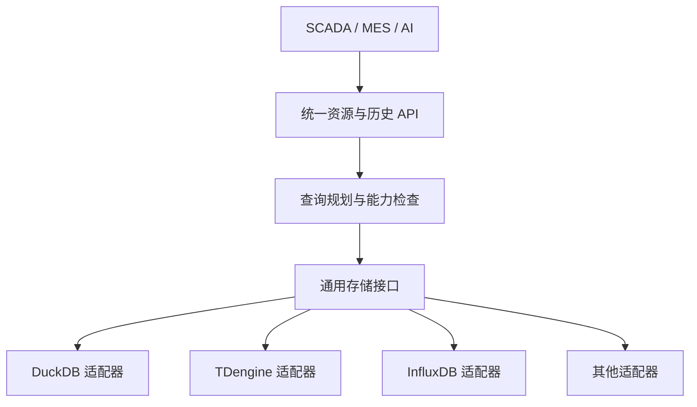

# 外部 TSDB 共性接口与差异能力设计

状态：设计草案，未实现、未完成真实数据库版本验证。本文细化 [时序数据库设计](timeseries-storage.md) 和 [存储适配器契约](storage-adapter-contract.md)，符合 [数据引擎边界](../architecture/data-engine-scope.md)。若与上位规范冲突应先登记解决；示例 JSON 不是最终 API / 配置 Schema。

## 1. 设计目标

上层应用只使用统一的资源 ID 和数据语义，不依赖某个 TSDB 的表名或查询语言；引擎通过适配器支持多种数据库，并使无法一致支持的能力明确可见。统一数据结果不意味着每个后端具备同样的功能、精度或可靠性。

两类接入分开：managed_ingest（引擎持久接收后投递至存储目标）与 referenced_read（只读引用已有库的数据）。引用模式不能默认支持写入、消息 ID、质量、实时订阅、本地 WAL 或无损补传。DuckDB 2.0.0 仍是默认本地目标，外部 TSDB 为后续实际验证。

## 2. 三层接口



1. **北向统一数据服务**：资源、实时值、标准历史查询 / 订阅；严格约束调用服务的身份和可信范围。用户、角色、业务权限归上层。
2. **通用接口及能力描述**：定义数据、查询、写入结果与错误语义，并根据目标、版本和配置描述能力。
3. **数据库适配器与可选扩展**：完成连接、字段绑定、目标协议编码、请求下推和结果转换；不支持的语义不能伪装成功。

“数据库特性”通过有版本的**命名扩展**暴露给可信上层，必须通过类型 / 范围 / 租户检查；不接受任意 SQL、PromQL、连接地址或脚本作为普通 API 输入。专用分析 API 仅在有明确业务需求、经隔离授权和资源限制后单独设计，不默认开放。

## 3. 通用接口设计

下表描述语义，不是已实现的 Rust trait；所有调用均有服务身份、可信范围、request_id、deadline、配额和取消语义。

| 接口 | 输入 | 输出 / 保证 |
|---|---|---|
| describe_capabilities | target_id、目标配置版本 | 带版本与证据的能力快照，未验证不能声明支持 |
| health | target_id | 连接 / 读写能力分开；健康检查不证明数据一致 |
| validate_binding | source_ref、类型 / 单位 / 质量需求 | 兼容性、失败项及证据；不允许透出凭据 |
| write_batch | target_id、批次、标准观测、稳定 ID | 每项 committed / retryable / permanent_rejected / unknown；仅对支持写入目标 |
| read_latest | resource_ids、质量与时间要求 | 每资源值、时间、质量、来源及缺失原因；referenced_read 能力单独检查 |
| query_raw | 资源、[start,end)、筛选、顺序、页大小 / cursor | 标准记录流及 snapshot / weak、partial、coverage、warning |
| query_aggregate | 资源、窗口、聚合、质量与填充 | 只开放目标能正确表达或已验证的计算 |
| subscribe | 资源过滤及消费能力 | 仅在明确支持时开放；轮询模拟必须标记模式与延迟，不能宣称事件完整 |
| shutdown | target_id | 停止接收新任务、按状态刷新 / 关闭，超时则保留未确认状态 |

资源发现、树、模型、业务语义由引擎元数据层负责，不把外部库的表名作为北向资源身份。取消查询不能暗示已撤销数据库端写入。

## 4. 标准观测模型

| 字段 | 类型及说明 | 缺失处理 |
|---|---|---|
| resource_id | 已授权范围内的稳定资源 | 不得省略 |
| observation_id | 稳定逻辑观测身份 | 已有库没有时不可凭空宣称稳定 ID；可只读并披露限制 |
| value / value_type / unit | 类型化工程值及单位 | 未知单位标记 unknown，禁止猜测换算 |
| source_at_ms / time_origin | UTC 毫秒与时钟来源 | 数据库精度不足时报告精度与损失 |
| received_at_ms | 引擎接收时刻 | 引用数据未经过引擎接收时允许缺失并说明 |
| quality / source_quality_code | 归一化质量及原始码 | 无质量列 → unknown，不默认为 good |
| model_revision_id / binding_revision_id | 观测或映射版本 | 外部历史无法追溯时标记 unknown；不能借当前版本冒充历史 |
| source / mode | 目标 / 连接、managed_ingest 或 referenced_read | 必须标明 |

source / 表 / 字段由受控绑定解析；普通调用只使用 resource_id。已存在数据库可能无法提供 observation_id、质量、入站时间等；适配器必须公开缺失和限制，不虚构。

## 5. 能力协商和分级

接口名一样，具体支持能力按数据库版本、目标配置和适配器版本确定，取值 supported / unsupported / conditional / unverified，并记录测试证据与过期条件。

| 能力 | 需说明的具体语义 |
|---|---|
| read_latest / raw_query | 时间来源、排序、空值、最大范围、缺失质量 |
| aggregate / interpolation | 具体函数、窗口对齐 / 时区、单位与质量、插值适用类型 |
| same_timestamp_distinct | 同一资源同毫秒能否保留多个独立观测 |
| stable_observation_id | 能否存储、查询及稳定分页 |
| replay_idempotent | 同 ID 同内容在丢失 ACK 后重放是否已验证 |
| batch_result_scope | 逐条 / 整批 / 可能部分成功但无法判别 |
| time_precision | 输入、实际保存和返回的精度及溢出行为 |
| stable_pagination | 快照或固定水位，结果的迟到数据边界 |
| realtime_subscription | 原生订阅 / 轮询、延迟、重连及缺口行为 |
| quality_roundtrip | 状态、原始质量码和 freshness 是否可恢复 |

握手不能仅由数据库版本名猜测：配置、部署模式、参数和权限也会改变语义。版本或配置变化使能力快照失效；严格模式缺少必需能力时阻止目标启用。禁止用探测结果绕过上层授权；健康成功不是幂等或数据安全证据。

## 6. 异性能力如何提供

### 6.1 共性优先

统一能力覆盖资源点位、单点 / 批量 latest、原始历史、基础聚合、数据范围、保留时间（可发现时）和健康。实际上能否支持由能力快照裁决，不能因为接口中存在就假设每个数据库已支持。

### 6.2 可选下推与引擎执行

例如按分钟求平均压力：

1. 统一查询先确定资源授权、时间区间、数值类型、单位与质量过滤。
2. 若目标聚合能保证窗口、空值与质量语义，适配器可下推。
3. 否则目标若支持足量 raw 且未超内存、数量、时限，可经调用方显式允许在引擎内聚合；不得静默获取无限数据。
4. 如果要求精确但后端不能提供足够事实，则返回 CAPABILITY_UNSUPPORTED 或 QUERY_LIMIT_EXCEEDED，而不是返回看似正常的近似数值。
5. 结果标明 aggregation、execution_location、quality_filter、coverage、consistency 与 partial。

### 6.3 数据库特有扩展

扩展采用 vendor.namespace + version + operation + 参数 Schema + 能力测试，不得覆盖通用字段或权限。举例：某目标支持特定窗口或查询算子，可由专用客户端在经过授权后使用；缺少能力返回 EXTENSION_UNSUPPORTED。不能声称扩展支持其他数据库，也不为扩展放开任意数据库访问。

## 7. 示例：同一查询、多种来源

假定调用方请求 1 号水泵出口压力在指定 UTC 范围内的 1 分钟平均值，只包括 good 数据。示意请求：

```json
{
  "resources": ["res-pump-001-pressure"],
  "range": {"start_ms": 1793865600000, "end_ms": 1793869200000},
  "quality_states": ["good"],
  "query": {"mode": "aggregate", "function": "avg", "window_ms": 60000, "alignment": "utc_epoch", "fill": "none"},
  "requirements": {"allow_engine_compute": false, "require_complete": true},
  "limit": 1000
}
```

流程：资源 ID → 经授权的绑定快照 → 精确目标 / 数据源字段映射 → 能力与范围检查 → 目标专属请求 → 统一结果及质量、范围、后端版本。若 referenced_read 的质量列不存在，不可把未知质量归为 good；该查询应拒绝或明确返回不能完成要求。时区、页大小和窗口限制需正式契约冻结。

返回示例结构包括 resource_id、window_start_ms、window_end_ms、value、unit、aggregation、quality_summary；元信息包括 target_id、source_mode、capability_revision、execution_location、complete / partial、warnings、consistency 和结果水位。仅当能证明覆盖完整时标记 complete；后端停机 / 结果缺口不能以空数组伪装成窗口内无数据。

## 8. 几类数据库的差异及适配策略

以下仅代表设计关注点，不构成实测矩阵；锁定每个数据库版本 / 部署模式后实测。

| 数据库 | 物理表达方向 | 主要差异及测试 |
|---|---|---|
| DuckDB 2.0.0 | 默认本地类型化历史表 | 事务、批量写、同毫秒多观测、单进程边界和恢复 |
| TDengine | 超级表 / 子表 / metric / tag；仅为候选 | 精确主键与同时间更新、跨 vnode 批次部分成功、schema / 版本和查询能力 |
| TimescaleDB | PostgreSQL 超表、列与索引 | 时间分区、唯一键约束与事务，当前 SQL / 扩展版本 |
| InfluxDB 3 Core | 表、tag 集、field、时间戳 | 相同表 / tag / 时间可能合并；普通 field 中的 observation_id 不足以保证不同观测分离 |
| VictoriaMetrics | 指标序列与标签 | 配置去重 / 降采样可能减少原始样本，文本、质量和 observation_id 是否可恢复需验证 |

不同版本不得共享未经确认的能力结论。能表达数值曲线不等于能原样表达完整工业观测。特别是单资源同毫秒多条独立观测：不能通过修改源时间或把每个 observation_id 变为高基数标签而默许无损；如选择特殊映射必须记录语义、成本和验证。缺乏该能力时按受控的有损策略声明 / 拒绝，不能声称和默认 DuckDB 等价。

## 9. managed_ingest 投递与恢复

入站 durable ACK 仅代表引擎应用 WAL 到达配置同步边界，不表示外部数据库已写入。WAL 记录、observation_id 和 payload hash 在重放时不变；每个目标独立 delivery_state 和连续 checkpoint。

- 目标确定成功 → committed；确定未发送 → 可重试。
- 超时 / 响应丢失 / 部分结果不明 → unknown，先查回或仅在已验证目标幂等时重试。
- 例如 101 committed、102 unknown、103 committed，checkpoint 不能越过 102；103 的完成状态仍须持久化。
- 必需目标未追平时不能回收所需 WAL；容量耗尽按可靠接收策略背压，不虚报 durable 或远端成功。
- 长期不可写的记录须隔离或经授权登记缺口；不能静默跳过并声称数据完整。

referenced_read 不自动使用此投递链，不提供无损重放承诺。

## 10. 时间、质量、类型和安全

- 输入时间按已约定的 UTC 毫秒；如果目标只有秒精度或截断，严格模式拒绝，不能静默改变时间。
- 缺失质量映射为 unknown；保留可用原始质量码，过期 freshness 与质量分开。
- 数值 / bool / text / enum / JSON 的真实后端支持须逐项测试；不支持拒绝而非转换成字符串或 0。
- 采样、源接收 / 入库、查询时间分开；老数据不能误标为当前值。
- 服务间身份与范围必须校验；普通终端不能直连数据库绕过上层授权。连接凭据仅存安全引用；日志 / 报文 / AI 目录脱敏。
- 资源数量、跨度、点数、扫描量、聚合窗口、并发、超时与成本限定，防止跨源查询耗尽内存或造成现场库压力。

## 11. 测试与交付顺序

P0：先完成 DuckDB 的标准观测、WAL / 幂等及最小查询；一个数据源 / 一个设备 / 多次观测。P1：按真实客户选择**一个**外部库进行 referenced_read 或 managed_ingest 的明确子集，不能同时声称所有库已支持。

验收：
- C01 相同逻辑查询在两个后端返回一致单位、质量过滤和半开时间边界（能力可满足时）。
- C02 同一毫秒两个独立 ID；目标不能分辨则严格模式拒绝。
- C03 目标未保存质量时 good-only 查询不可假装完成。
- C04 超时后远端写入结果未知，不得自动假定失败；检查点不跨空洞。
- C05 不支持查询函数 / 插值 / 快照分页，明确报能力错误或返回经允许且标记的弱一致结果。
- C06 非授权资源的 latest、raw、aggregate、订阅和扩展全部不可见。
- C07 目标配置 / 版本变化使旧能力证据失效。
- C08 真实历史库只读引用时标识未知 source ID / 质量，不能虚构本地 WAL 与重放。
- C09 比较引擎聚合与目标下推的窗口 / 质量语义；数据过多时拒绝而不是无限搬运。
- C10 元数据绑定改版后，历史按实际版本或 unknown 返回，不能套用当前地址当作过去事实。

每项记录真实产品 / 版本、驱动版本、设置、预期、原始输入输出、数据条数、重复 / 丢失及错误证据；当前全部未执行。

## 12. 参考

- TDengine 写入行为：https://docs.tdengine.com/tdengine-sql/data-write/insert/
- InfluxDB 3 Core 行协议与重复点：https://docs.influxdata.com/influxdb3/core/reference/line-protocol/
- VictoriaMetrics 去重：https://docs.victoriametrics.com/victoriametrics/
- DuckDB Rust 数据导入：https://duckdb.org/docs/2.0/clients/rust/data_import
